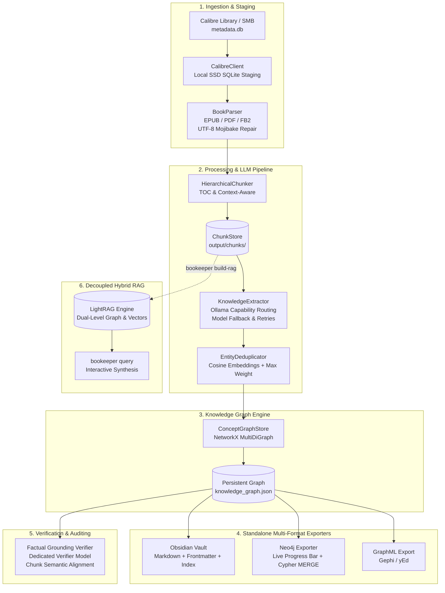

# 📚 bookeeper

> **Calibre library & download folder ingester, LLM metadata normalizer, and Concept Knowledge Graph extractor using local Ollama.**

`bookeeper` bridges your digital book library (EPUB / PDF / FB2 via Calibre or direct download directories such as `archive_downloader/downloads`) with local Large Language Models (Ollama) to extract structured ideas, architectural patterns, technical themes, and concept graphs mapped down to individual chapters and sections.

---

## 📖 Documentation Sitemap

The documentation is split into specialized subchapters stored in the [`docs/`](docs/) directory:

| Chapter | Description |
| :--- | :--- |
| 🔄 **[Recommended Workflow](docs/workflow.md)** | **Start here**: Calibration via small A/B tests, building knowledge graph, export, and optional POC post-processing. |
| 🚀 **[Getting Started](docs/get-started.md)** | Prerequisites, installation (`uv`/`pip`), configuration walkthrough, and basic commands. |
| 🏗️ **[Building the Knowledge Graph](docs/building-graph.md)** | Graph extraction pipeline, chronological ingestion, 3-tier semantic routing, offline rebuilds, pruning, incremental Neo4j sync, and index suspension. |
| 🌐 **[Interactive Web UI & Search](docs/ui.md)** | **Idea Search & Explorer**: Interactive Cytoscape Neo4j graph, dedicated **💡 Ideas Page** (exact, embedded vector search, modernity range filter), Obsidian note panel, and embedded LightRAG WebUI. |
| 🔍 **[Decoupled Hybrid RAG](docs/rag.md)** | LightRAG vector/graph indexing from cached chunks and multi-mode querying (`hybrid`, `local`, `global`). |
| 🧪 **[Two-Pass Idea Post-Processing (POC)](docs/post-processing.md)** | **Experimental POC**: second-pass entity synthesis, clustering, at-most-once LLM refinement, and state checkpointing. |
| 🔬 **[A/B Testing & Benchmarking](docs/ab-tests.md)** | Automated test harness, same-branch vs branch-vs-branch testing, configuration overlays, and delta reporting. |
| 🛡️ **[Factual Verification & Auditing](docs/verification.md)** | Multi-mode verification suite: Ideas Grounding, Chunk Coherence, Dual-KG Cross-Checking, and Oracle QA probes. |

---

## 💻 High-Level Command Reference

Bookkeeper provides a rich set of CLI commands. Below is a high-level overview of available commands:

| Command | Syntax Example | Primary Purpose | Detailed Guide |
| :--- | :--- | :--- | :--- |
| **`ui`** | `bookeeper ui --lightrag-server` | Launches interactive Web UI with Cytoscape Neo4j graph, dedicated **💡 Ideas Page** (exact/vector search & modernity filtering), Obsidian panel, and LightRAG WebUI. | [Web UI Guide](docs/ui.md) |
| **`lightrag-ui`** | `bookeeper lightrag-ui --port 9621` | Starts the official embedded LightRAG FastAPI server with document manager and workspace query UI. | [Web UI Guide](docs/ui.md) |
| **`build-graph`** | `bookeeper build-graph --limit 5 --skip-limbo-chunks` | Ingests books chronologically, runs 3-tier semantic chunk routing, and extracts concepts into `knowledge_graph.json`. | [Building Graph](docs/building-graph.md) |
| **`rebuild-graph`** | `bookeeper rebuild-graph` | Fast offline rebuild of the graph from `.book_states/` in seconds without LLM inference. | [Building Graph](docs/building-graph.md) |
| **`query`** | `bookeeper query "Explain Paxos"` | Queries the library using LightRAG hybrid retrieval (local entity graphs + global summaries). | [Hybrid RAG](docs/rag.md) |
| **`build-rag`** | `bookeeper build-rag` | Indexes pre-computed SSD chunks into LightRAG independently from book ingestion. | [Hybrid RAG](docs/rag.md) |
| **`postprocess-ideas`** | `bookeeper postprocess-ideas` | **(Experimental POC)** At-most-once LLM synthesis of multi-occurrence ideas with untouched cluster skipping and state checkpointing. | [Post-Processing](docs/post-processing.md) |
| **`verify`** | `bookeeper verify --mode ideas` | Audits factual grounding of ideas, chunk boundary coherence, or cross-KG NLI entailment. | [Verification](docs/verification.md) |
| **`verifiers`** | `bookeeper verifiers` | Runs all configured verification suites from `config.yaml` concurrently. | [Verification](docs/verification.md) |
| **`test-run`** | `bookeeper test-run 5` | End-to-end integration test: builds a clean graph for $N$ books, then automatically verifies grounding. | [Verification](docs/verification.md) |
| **`export`** | `bookeeper export --clean --backfill-embeddings` | Exports Knowledge Graph to Obsidian, GraphML, and Neo4j, with optional automatic embedding backfill. | [Building Graph](docs/building-graph.md) |
| **`export-obsidian`** | `bookeeper export-obsidian` | Exports graph to an Obsidian Markdown vault with Wikilinks, tags, and significance index. | [Building Graph](docs/building-graph.md) |
| **`export-neo4j`** | `bookeeper export-neo4j --clean` | High-throughput Cypher upsert with search index suspension, parallel HNSW rebuild, and Rich progress. | [Building Graph](docs/building-graph.md) |
| **`remove-book`** | `bookeeper remove-book 42` | Safely removes a book, its sections, chunks, and orphan concepts from the graph. | [Building Graph](docs/building-graph.md) |
| **`clean-metadata`** | `bookeeper clean-metadata --limit 50` | Uses Ollama to normalize, clean, and fix encoding for titles/authors/summaries in Calibre. | [Get Started](docs/get-started.md) |
| **`list-books`** | `bookeeper list-books --search "AI"` | Discovers, lists, and searches books in Calibre or direct download directories. | [Get Started](docs/get-started.md) |
| **`status`** | `bookeeper status` | Displays progress checkpoints, completed book counts, assigned fast-path chunks, and skipped limbo chunks. | [Get Started](docs/get-started.md) |
| **`stats`** | `bookeeper stats` | Displays graph metrics (node counts, edge counts, categories, significance weights). | [Get Started](docs/get-started.md) |
| **`config`** | `bookeeper config` | Displays active settings, resolved server pool, and node capabilities. | [Get Started](docs/get-started.md) |
| **`backup`** | `bookeeper backup -o backup.zip` | Creates a compressed archive (`.zip` / `.7z`) of the graph, vault, chunks, and book states. | [Get Started](docs/get-started.md) |
| **`restore`** | `bookeeper restore backup.zip --clean` | Restores knowledge graph, vault, chunks, and checkpoints from an archive. | [Get Started](docs/get-started.md) |
| **`ab-compare`** | `bookeeper ab-compare backup_a.zip [backup_b.zip]` | Instant comparative A/B evaluation between archived backups or active graph in isolated temp directories. | [A/B Testing](docs/ab-tests.md) |

---

## 🏗️ Architecture & Pipeline



---

## 🌐 Distributed Multi-Node Ollama Cluster

Bookkeeper includes an intelligent multi-server routing engine designed for distributed compute clusters (e.g. powerful GPU servers, local Apple Silicon Macs, and CPU nodes):

- **Capability-Based Routing**: Tasks are dispatched strictly to nodes that advertise required capabilities (`llm`, `embedding`, `verification`).
- **Priority Failover & Separate Cooldowns**: Ordered by priority (1 is highest). Failed nodes enter a temporary cooldown (`analysis_cooldown_seconds: 600s` for heavy book analysis, `verification_cooldown_seconds: 60s` for quick audit retries).
- **Dedicated Offloading vs. Cluster Pool for Embeddings**:
  - `embedding_base_url: "http://localhost:11434"`: Offloads embeddings to a dedicated local endpoint (eliminating model-swapping latency on GPU servers).
  - `embedding_base_url: "pool"`: Concurrent sub-batch splitting and round-robin load distribution across all healthy nodes advertising `embedding` capability.
- **Size-Aware Dynamic Embedding Batching**: Automatically partitions text collections (sentences, chunks, ideas) into size-aware batches based on byte length and token counts.
- **Embedding Reuse & Auto-Backfill**: Caches and reuses computed embeddings across chunks and ideas; offers automatic backfill (`--backfill-embeddings`) during export without re-ingestion from scratch.
- **Fault-Tolerant Retries & Model Fallback**: Defers difficult chunks to the end of the run; automatically switches to `llm_model_fallback` (e.g. `llama3.1:8b`) after 50% chunk retry failures.
- **Full UTF-8 Mojibake Repair**: Cyrillic and complex multilingual character encodings (Windows-1251, ISO-8859-1, KOI8-R) are automatically repaired at every stage.

---

## ⚡ High-Throughput Graph Ingestion & Neo4j Vector Sync

To handle massive knowledge bases efficiently without ingestion lag or GPU bottlenecks, Bookkeeper incorporates specialized architectural patterns:

- **Chronological Book Ingestion & Idea Modernity Tracking**: Books are ingested chronologically by publication/file date. Ideas track `first_occurrence_month` and `month` (`YYYY-MM`), with earlier dates winning to reflect idea provenance.
- **3-Tier Semantic Chunk Routing (`--skip-limbo-chunks`, `--max-batch-chunk-size`)**:
  - **Priority 1 (Unassigned / Brand New)**: Similarity $< 0.65$ triggers full LLM extraction.
  - **Priority 2 (High-Confidence Fast-Path)**: Similarity $\ge 0.90$ directly assigns chunks to existing ideas, bypassing LLM calls entirely.
  - **Priority 3 (Limbo Chunks)**: $0.65 \le \text{sim} < 0.90$. Skipping these via `--skip-limbo-chunks` provides massive speedups for large libraries.
  - **Forced Chunk Size Recovery (`--max-batch-chunk-size`)**: If a limbo chunk is this character size or bigger, it is forcibly recovered from limbo and restored to the Priority 1 unprocessed queue, even if embeddings suggested limbo or skipping. Resuming with this threshold also recovers previously skipped limbo chunks.
- **Neo4j Search Index Suspension**: During bulk node and edge exports, Bookkeeper discovers and temporarily suspends `VECTOR` (`idea_idx`, `chunk_idx`) and `FULLTEXT` indexes while preserving unique ID constraints for $O(1)$ `MERGE`. Indexes are recreated in parallel post-ingestion and polled until reaching `ONLINE` state.
- **Incremental Batch Sync**: Automatically exports only affected (dirty) nodes and edges after each configured book batch (default: 10 books).
- **At-Most-Once LLM Refinement**: The `IdeaPostProcessor` clusters ideas semantically across the whole graph, but synthesizes each cluster at most once (tracking via `refined` state flags), bypassing thousands of untouched clusters in seconds.

---

## 📁 Repository Structure

```text
bookeeper/
├── docs/                     # Comprehensive documentation subchapters
│   ├── get-started.md        # Installation, configuration, and basic commands
│   ├── building-graph.md     # Graph extraction, rebuilds, exports, and pruning
│   ├── rag.md                # Decoupled LightRAG indexing and querying
│   ├── post-processing.md    # Two-pass idea aggregation and state checkpointing (POC)
│   ├── ab-tests.md           # Automated A/B testing harness and overlays
│   └── verification.md       # Grounding audits, cross-checking, and Oracle testing
├── config.yaml               # User configuration (Ollama pool, Calibre, Neo4j, LightRAG, Verifier)
├── config.yaml.example       # Example configuration template with full options
├── pyproject.toml            # Project dependencies & CLI entrypoint
├── src/
│   └── bookeeper/
│       ├── cli.py            # Typer / Rich CLI commands with live progress indicators
│       ├── backup.py         # Knowledge backup & restoration engine (ZIP and 7-Zip)
│       ├── config.py         # Pydantic v2 settings loader with server capabilities
│       ├── calibre/          # SQLite reader & EPUB/PDF parser with encoding repair
│       ├── processing/       # Chunking, extraction, deduplication, pooling, and postprocessor
│       ├── graph/            # NetworkX graph store, Obsidian, and Neo4j exporters
│       └── rag/              # LightRAG hybrid retrieval engine wrapper
├── archive_downloader/       # Standalone arXiv & scientific paper downloader
└── tests/                    # Pytest test suite (240+ unit & integration tests)
```

---

## ⚡ Quick Start

For full installation and setup instructions, see the **[Getting Started Guide](docs/get-started.md)**.

```bash
# 1. Install dependencies with uv:
uv venv && source .venv/bin/activate
uv pip install -e ".[dev]"

# 2. Configure environment:
cp config.yaml.example config.yaml

# 3. Test connectivity and list books:
bookeeper list-books --limit 10

# 4. Ingest 3 books from scratch into Knowledge Graph:
bookeeper build-graph --limit 3 --from-scratch --no-lightrag

# 5. Audit factual grounding:
bookeeper verify --mode ideas --percent 2.0
```

---

## 🧠 Concept Significance Weighting

Every extracted idea and concept is assigned a significance weight on a scale from **0 to 10**:

| Weight | Classification | Description & Examples |
| :---: | :--- | :--- |
| **0 – 2** | Generic / Primitive | Common notions, foundational terminology (*e.g.* `Identification`, `Measurement`, `User`). |
| **3 – 5** | Foundational Discipline | Standard principles and formal methodologies (*e.g.* `Risk Assessment`, `Database Normalization`). |
| **6 – 8** | Specific Architecture / Tech | Distinct technical patterns and concrete frameworks (*e.g.* `RAG`, `Event Sourcing`, `WAL`). |
| **9 – 10** | Specialized / Cutting-Edge | Original, deeply philosophical, or specialized concepts (*e.g.* `SmartRAG`, `Byzantine Fault Tolerant Raft`). |

- **Automatic Merging**: Deduplicated concepts retain the maximum observed weight (`max(canonical.weight, incoming.weight)`).
- **Obsidian Frontmatter**: Notes include `weight: <W>` and the master index `00_Index.md` is sorted by weight descending.
- **Neo4j Property**: Stored directly on `:Concept` nodes as `n.weight` for easy Cypher queries.

---

## 🧪 Running Tests

```bash
uv run pytest -v
```
