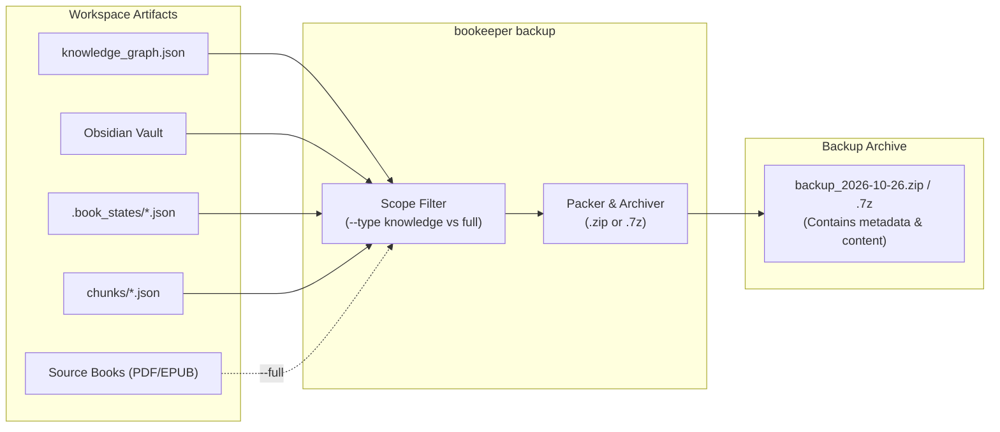

# 💾 Backup & Restore Subsystem

Bookkeeper includes an enterprise-grade standalone backup and restoration engine that packages Knowledge Graph artifacts, Obsidian vault notes, per-book state checkpoints, pre-computed chunks, and source books into portable, versioned archives (`.zip` or `.7z`).

---

## 📋 Table of Contents

- [1. Overview & Architecture](#1-overview--architecture)
- [2. Backup Types & Scopes](#2-backup-types--scopes)
  - [Knowledge-Only Backup (Default)](#knowledge-only-backup-default)
  - [Full Backup (`--full` / `--type full`)](#full-backup---full----type-full)
- [3. CLI Commands & Flags](#3-cli-commands--flags)
  - [`bookeeper backup`](#bookeeper-backup)
  - [`bookeeper restore`](#bookeeper-restore)
- [4. Automated Invariant & Integrity Checks](#4-automated-invariant--integrity-checks)
- [5. Integration with A/B Testing & Evaluation](#5-integration-with-ab-testing--evaluation)
- [6. Web UI Backup & Restore](#6-web-ui-backup--restore)

---

## 1. Overview & Architecture

Knowledge Base construction requires significant LLM inference time and embedding computations. The backup system ensures you can:
1. **Archive milestone runs** before testing different prompts, chunking algorithms, or clustering thresholds.
2. **Move datasets seamlessly** across machines or servers without rebuilding from scratch.
3. **Execute instant, offline A/B audits** using historical backups (`bookeeper ab-compare`).
4. **Restore state** safely with atomic extraction, integrity validation, and rollbacks.



---

## 2. Backup Types & Scopes

### Knowledge-Only Backup (Default)
Packages all generated semantic structures without duplicating large original book files:
* Knowledge Graph files (`knowledge_graph.json`, `knowledge_graph.graphml`).
* Obsidian Markdown notes vault (`obsidian_vault/`).
* Per-book processing state checkpoints (`.book_states/book_*_state.json`).
* Companion hierarchical text chunks and embeddings (`chunks/book_*_chunks.json`).
* Verification reports and stats.

### Full Backup (`--full` / `--type full`)
Includes everything from the **Knowledge-Only** backup **plus** the original digital source books (PDFs, EPUBs, MOBIs):
* By default, includes only the **indexed source books** that contributed to the graph.
* Adding `--all-books` packages all book files found in `--books-dir` regardless of indexing status.

---

## 3. CLI Commands & Flags

### `bookeeper backup`

```text
Usage: bookeeper backup [OPTIONS] [destination]
```

#### Arguments & Options

| Option / Flag | Type | Default | Description |
| :--- | :---: | :---: | :--- |
| `[destination]`, `-o`, `--output` | `PATH` | `./backup_<timestamp>.<ext>` | Destination archive file path (e.g. `backup.zip`, `my_run.7z`) or output directory. |
| `-f`, `--format` | `STR` | Auto / `zip` | Archive compression format: `zip` or `7z`. |
| `-t`, `--type` | `STR` | `knowledge` | Backup type: `knowledge` or `full`. |
| `--full` | `FLAG` | `False` | Shorthand flag to create a full backup (knowledge + indexed books). |
| `-b`, `--books-dir` | `PATH` | Config `books_dir` | Directory containing source books for full backups. |
| `--all-books` | `FLAG` | `False` | For full backups: include all books in `books_dir` instead of only indexed books. |
| `--output-dir` | `PATH` | Config `output_dir` | Source directory containing graph artifacts. |
| `-c`, `--config` | `PATH` | `None` | Path to `config.yaml`. |
| `--calibre-path` | `PATH` | `None` | Custom path to Calibre library. |
| `--no-chunks` | `FLAG` | `False` | Exclude `chunks/` directory from the archive. |
| `--no-obsidian` | `FLAG` | `False` | Exclude Obsidian vault notes from the archive. |
| `--no-states` | `FLAG` | `False` | Exclude `.book_states/` checkpoints from the archive. |
| `--no-lightrag` | `FLAG` | `False` | Exclude LightRAG database directory from the archive. |

#### Usage Examples

```bash
# 1. Standard knowledge backup in default ZIP format:
bookeeper backup

# 2. Save directly to a specific folder:
bookeeper backup ./backups/

# 3. Create a high-compression 7-Zip archive (.7z):
bookeeper backup -f 7z -o ./backups/october_run.7z

# 4. Create a full backup including indexed source PDFs/EPUBs:
bookeeper backup --full -o ./backups/full_archive.zip

# 5. Full backup containing ALL books in downloads directory:
bookeeper backup --full --all-books --books-dir ./archive_downloader/downloads -o full_all.zip

# 6. Minimal graph backup excluding chunks and states:
bookeeper backup --no-chunks --no-states -o minimal.zip
```

---

### `bookeeper restore`

```text
Usage: bookeeper restore [OPTIONS] [archive_path]
```

#### Arguments & Options

| Option / Flag | Type | Default | Description |
| :--- | :---: | :---: | :--- |
| `[archive_path]`, `-i`, `--input` | `PATH` | Required | Path to the `.zip` or `.7z` backup archive. |
| `-o`, `--output-dir` | `PATH` | Config `output_dir` | Target directory to extract knowledge artifacts into. |
| `-b`, `--books-dir` | `PATH` | Config `books_dir` | Target directory to extract source books into (for full backups). |
| `--clean` | `FLAG` | `False` | Wipe existing knowledge graph, Obsidian vault, chunks, and states before restoring. |
| `--dry-run` | `FLAG` | `False` | Inspect archive manifest, count files, and show summary table without writing. |
| `-c`, `--config` | `PATH` | `None` | Path to `config.yaml`. |
| `--calibre-path` | `PATH` | `None` | Custom path to Calibre library. |

#### Usage Examples

```bash
# 1. Dry-run inspect archive contents without modifying disk:
bookeeper restore ./backups/october_run.7z --dry-run

# 2. Restore into a clean destination directory:
bookeeper restore ./backups/october_run.7z --clean --output-dir ./restored_output

# 3. Restore full archive including source books:
bookeeper restore ./backups/full_archive.zip --books-dir ./restored_books
```

---

## 4. Automated Invariant & Integrity Checks

When restoring from an archive, Bookkeeper performs strict verification:
1. **Archive Safety**: Prevents path traversal vulnerabilities (`zip slip` / absolute paths).
2. **Graph JSON Schema Validation**: Verifies `nodes`, `edges`, and required attributes before committing.
3. **Calibre SQLite Integrity**: Audits `metadata.db` schema and index consistency before writing.
4. **Atomic Restores**: Restores staging files first, ensuring existing knowledge bases are not left corrupted if a process is interrupted.

---

## 5. Integration with A/B Testing & Evaluation

Backups serve as first-class targets for evaluation and benchmarking without manual unzipping:

```bash
# Direct A/B comparison between two compressed archives:
bookeeper ab-compare backups/run_a.zip backups/run_b.7z --mode stats

# Deep NLI Cross-Check between a historical backup and current active graph:
bookeeper ab-compare backups/baseline.zip --mode cross-check --blocks 10

# Graph Space coverage audit on an archived backup:
bookeeper verify --graph-file backups/run_a.zip --mode kg --tau 0.75
```

---

## 6. Web UI Backup & Restore

Bookkeeper's Web UI provides a dedicated interface:
* Access via the **💾 Backup & Restore** navigation tab (`?tab=backup`).
* Choose between **Knowledge Only** and **Full Backup**.
* Trigger backups, download generated `.zip` / `.7z` archives via direct browser download, or drag-and-drop an archive to restore with live progress updates.
