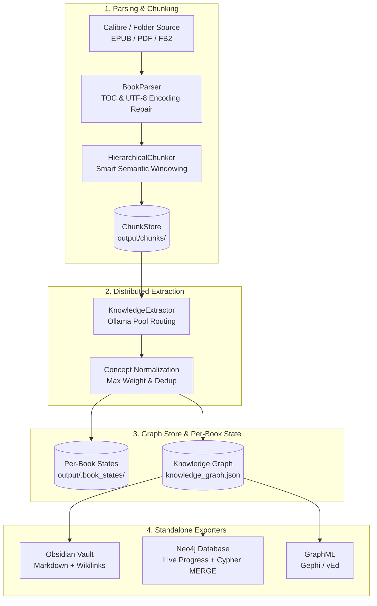

# 🏗️ Building the Knowledge Graph

Bookkeeper extracts structured ideas, architectural principles, domain patterns, and relational concepts from digital books and maps them into an interconnected **Concept Knowledge Graph**.

---

## 📋 Table of Contents

- [1. Ingestion & Extraction Architecture](#1-ingestion--extraction-architecture)
- [2. Supported Book Sources](#2-supported-book-sources)
- [3. Running `build-graph`](#3-running-build-graph)
  - [Common Usage Patterns](#common-usage-patterns)
  - [Full Flag Reference](#full-flag-reference)
- [4. Instant Offline Rebuilds (`rebuild-graph`)](#4-instant-offline-rebuilds-rebuild-graph)
- [5. Removing Books (`remove-book`)](#5-removing-books-remove-book)
- [6. Concept Significance Weighting (0 to 10)](#6-concept-significance-weighting-0-to-10)
- [7. Standalone Exporters (No Book Re-Processing)](#7-standalone-exporters-no-book-re-processing)
  - [Obsidian Markdown Vault (`export-obsidian`)](#obsidian-markdown-vault-export-obsidian)
  - [Neo4j Property Graph (`export-neo4j`)](#neo4j-property-graph-export-neo4j)
  - [Unified Export (`export`)](#unified-export-export)
- [8. Next Steps](#8-next-steps)

---

## 1. Ingestion & Extraction Architecture



---

## 2. Supported Book Sources

Bookkeeper supports two distinct ingestion sources:

### A. Calibre Library (Local or Mounted SMB Share)
Reads metadata and paths directly from `metadata.db`:
- **SSD Staging**: When `stage_metadata_db: true` is configured, Bookkeeper copies `metadata.db` to local SSD to perform instant queries and avoids file-locking issues over network shares.
- **Remote Backup Safety**: Automatically creates `metadata.db.bak` before syncing back updates.

### B. Direct Download Directory (e.g., arXiv Papers)
Directly ingests collections of EPUBs and PDFs from a folder without requiring Calibre:
```bash
bookeeper build-graph --books-dir archive_downloader/downloads --limit 10
```

---

## 3. Running `build-graph`

The `build-graph` command ingests book sections, computes hierarchical chunks, extracts grounded concepts via Ollama, merges duplicates, and serializes the persistent graph into `output/knowledge_graph.json`.

### Common Usage Patterns

```bash
# 1. Continue indexing books from where you left off (resumes from checkpoint):
bookeeper build-graph

# 2. Continue processing from the next unprocessed book (relative to existing graph):
bookeeper build-graph --continue

# 3. High-performance run (bypasses LightRAG indexing during extraction):
bookeeper build-graph --no-lightrag

# 4. Ingest up to N books and stop (e.g. 5 books):
bookeeper build-graph --limit 5

# 5. Process all books in the library:
bookeeper build-graph --all

# 6. Ingest a specific book by Calibre ID:
bookeeper build-graph --book-id 42

# 7. Ingest a standalone EPUB or PDF directly:
bookeeper build-graph --file "/path/to/my_book.epub"

# 8. Retry failed books recorded in the checkpoint state:
bookeeper build-graph --retry-failed

# 9. Wipe checkpoint state, delete existing graph, and rebuild from scratch:
bookeeper build-graph --from-scratch

# 10. Automatically export to Neo4j with clean start:
bookeeper build-graph --export-neo4j --clean-export
```

### Full Flag Reference

| Flag | Description | Default |
| :--- | :--- | :--- |
| `--limit`, `-n` | Maximum number of books to successfully process before halting. | All |
| `--continue` | Continue from the next book relative to the existing graph. | False |
| `--all` | Force processing across all available books. | False |
| `--from-scratch` | Wipe existing graph, chunk cache, and checkpoints to rebuild from scratch. | False |
| `--book-id`, `-b` | Process a single specific Calibre book ID. | None |
| `--file`, `-f` | Direct path to a standalone EPUB/PDF file to ingest. | None |
| `--books-dir` | Path to folder of books/papers to use as source instead of Calibre. | From config |
| `--model`, `-m` | Primary Ollama LLM model for concept extraction. | From config |
| `--model-fallback` | Fallback Ollama LLM model used after chunk retry threshold. | From config |
| `--no-lightrag` | Disable simultaneous LightRAG indexing to accelerate graph extraction. | False |
| `--export-neo4j` | Automatically upsert the updated graph into Neo4j upon completion. | False |
| `--clean-export` | Purge existing Neo4j graph before upserting. | False |
| `--dual-pass` | Run experimental second-pass idea consolidation (POC). | False |

---

## 4. Instant Offline Rebuilds (`rebuild-graph`)

Whenever `build-graph` successfully processes a book, it preserves an authoritative extraction checkpoint inside `output/.book_states/book_<id>_state.json`.

The `rebuild-graph` command reconstructs the entire Knowledge Graph from these serialized book states **in seconds without running any LLM inference or re-chunking**:

```bash
# Rebuild the full Knowledge Graph from all existing book states:
bookeeper rebuild-graph

# Rebuild and immediately export to Neo4j:
bookeeper rebuild-graph --export-neo4j --clean-export

# Rebuild only a specific book ID from its state file:
bookeeper rebuild-graph --book-id 42

# Rebuild up to 5 books:
bookeeper rebuild-graph --limit 5
```

### Why use `rebuild-graph`?
- **Zero Compute Cost**: Does not call Ollama or embedding models.
- **Clean Slate Guarantee**: Wipes old `knowledge_graph.json`, Obsidian notes, and GraphML before reconstituting nodes, relationships, grounding links, and sequence edges.
- **Preserves Skipped Book Memorization**: Keeps failed/skipped format history intact in `.bookeeper_state.json`.

---

## 5. Removing Books (`remove-book`)

If a book was ingested accidentally or contains corrupted content, safely purge it and all associated orphaned nodes:

```bash
# Purge book #42 from the Knowledge Graph:
bookeeper remove-book 42

# Purge and refresh a custom Obsidian vault:
bookeeper remove-book 42 --export-obsidian ~/Documents/ObsidianVault
```

This command:
1. Removes the `Book` node and all its descending `Section` and `Chunk` nodes.
2. Identifies and removes **orphan concepts** that were exclusively mentioned in this book.
3. Clears the book from `.bookeeper_state.json` (allowing clean re-indexing if needed).
4. Deletes its cached `.book_states/book_42_state.json`.
5. Refreshes `knowledge_graph.json`, Obsidian notes, and GraphML exports.

---

## 6. Concept Significance Weighting (0 to 10)

Every extracted idea and concept is assigned a significance weight on a scale from **0 to 10**:

| Weight | Classification | Description & Examples |
| :---: | :--- | :--- |
| **0 – 2** | Generic / Primitive | Common notions, foundational terminology (*e.g.* `Identification`, `Measurement`, `User`). |
| **3 – 5** | Foundational Discipline | Standard principles and formal methodologies (*e.g.* `Risk Assessment`, `Database Normalization`). |
| **6 – 8** | Specific Architecture / Tech | Distinct technical patterns and concrete frameworks (*e.g.* `RAG`, `Event Sourcing`, `WAL`). |
| **9 – 10** | Specialized / Cutting-Edge | Original, deeply philosophical, or specialized concepts (*e.g.* `SmartRAG`, `Byzantine Fault Tolerant Raft`). |

- **Automatic Merging**: When concepts are deduplicated across chapters or books, the graph retains the maximum observed weight: `max(canonical.weight, incoming.weight)`.
- **Obsidian Frontmatter**: Notes include `weight: <W>` and the master index `00_Index.md` is sorted by weight descending.
- **Neo4j Property**: Stored directly on `:Concept` nodes as `n.weight` for easy Cypher queries:
  ```cypher
  MATCH (c:Concept) WHERE c.weight >= 7 RETURN c.name, c.weight ORDER BY c.weight DESC
  ```

---

## 7. Standalone Exporters (No Book Re-Processing)

Export your existing `knowledge_graph.json` directly to Obsidian, Neo4j, or GraphML without touching Calibre or Ollama:

### Obsidian Markdown Vault (`export-obsidian`)

Generates a fully navigable, Wikilink-connected Markdown vault:

```bash
# Export to default destination (output/obsidian_vault):
bookeeper export-obsidian

# Clean export to a custom vault directory:
bookeeper export-obsidian --clean --vault-dir ~/Documents/ObsidianVault
```

Vault Structure:
- `00_Index.md`: Master index grouped by category and sorted by significance weight.
- `Books/`: One note per book with metadata, author, and section outline.
- `Sections/`: Notes for chapters and sub-sections with breadcrumbs.
- `Concepts/`: Dedicated note per canonical concept with definition, quotes, and linked chunks.

### Neo4j Property Graph (`export-neo4j`)

Exports nodes and relationships into Neo4j via high-throughput Cypher `MERGE` queries with a live Rich progress bar:

```bash
# Export to Neo4j using credentials in config.yaml:
bookeeper export-neo4j

# Clean export (purges existing graph before importing):
bookeeper export-neo4j --clean
```

**Live Progress Bar Features:**
- **Schema Stage**: Verifies uniqueness constraints on node IDs.
- **Nodes Stage**: Live progress bar showing active node label (`:Book`, `:Section`, `:Chunk`, `:Concept`), items completed, rate, and ETA.
- **Relationships Stage**: Live progress bar showing active edge type (`:CONTAINS`, `:SUPPORTED_BY`, `:RELATES_TO`), items completed, rate, and ETA.

### Unified Export (`export`)

Export current graph to **all** configured destinations simultaneously:

```bash
bookeeper export --clean
```

---

## 8. Next Steps

- 🔍 **[Decoupled Hybrid RAG](rag.md)** — Index pre-computed chunks with LightRAG and perform interactive queries.
- 🧪 **[Two-Pass Idea Post-Processing (Experimental POC)](post-processing.md)** — Second-pass entity clustering and synthesis.
- 🛡️ **[Factual Verification & Auditing](verification.md)** — Verify factual grounding and coherence of your graph.
- 🏠 **[Return to Documentation Index](../README.md)**
