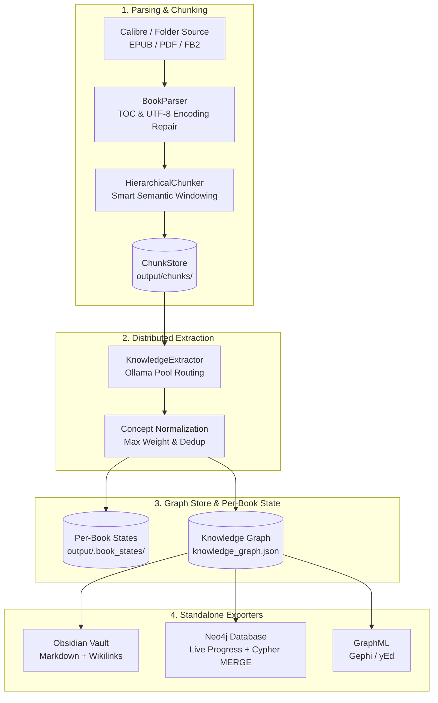
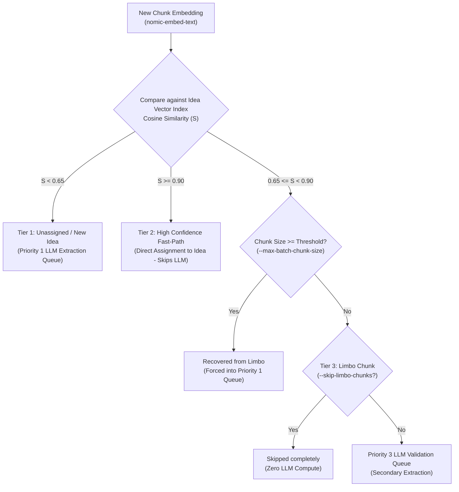

# 🏗️ Building the Knowledge Graph

Bookkeeper extracts structured ideas, architectural principles, domain patterns, and relational concepts from digital books and maps them into an interconnected **Concept Knowledge Graph**.

---

## 📋 Table of Contents

- [1. Ingestion & Extraction Architecture](#1-ingestion--extraction-architecture)
- [2. Supported Book Sources](#2-supported-book-sources)
- [3. Chronological Ingestion & Modernity Tracking](#3-chronological-ingestion--modernity-tracking)
- [4. 3-Tier Semantic Chunk Routing & Fast-Path](#4-3-tier-semantic-chunk-routing--fast-path)
- [5. Transparent 4-Step Book Finalization & Real-Time Progress](#5-transparent-4-step-book-finalization--real-time-progress)
- [6. Embedding Reuse & Dynamic Size-Aware Batching](#6-embedding-reuse--dynamic-size-aware-batching)
- [7. Running `build-graph`](#7-running-build-graph)
  - [Common Usage Patterns](#common-usage-patterns)
  - [Full Flag Reference](#full-flag-reference)
  - [Graceful Immediate Cancellation (Ctrl+C / SIGINT)](#graceful-immediate-cancellation-ctrlc--sigint)
- [8. Instant Offline Rebuilds (`rebuild-graph`)](#8-instant-offline-rebuilds-rebuild-graph)
- [9. Removing Books (`remove-book`)](#9-removing-books-remove-book)
- [10. Concept Significance Weighting (0 to 10)](#10-concept-significance-weighting-0-to-10)
- [11. Standalone Exporters & Neo4j High-Throughput Ingestion](#11-standalone-exporters--neo4j-high-throughput-ingestion)
  - [Obsidian Markdown Vault (`export-obsidian`)](#obsidian-markdown-vault-export-obsidian)
  - [Neo4j Property Graph (`export-neo4j`)](#neo4j-property-graph-export-neo4j)
  - [Search Index Suspension for High-Throughput Upserts](#search-index-suspension-for-high-throughput-upserts)
  - [Incremental Batch Neo4j Sync](#incremental-batch-neo4j-sync)
  - [Automatic Missing Embeddings Backfill](#automatic-missing-embeddings-backfill)
  - [Unified Export (`export`)](#unified-export-export)
- [12. Token Usage Statistics & Multi-Tier Cost Estimation](#12-token-usage-statistics--multi-tier-cost-estimation)
  - [Four Segregated Token Categories](#four-segregated-token-categories)
  - [Three Price Types for Each Section](#three-price-types-for-each-section)
  - [Comparative 3-Tier Industry Pricing Models](#comparative-3-tier-industry-pricing-models)
  - [Configuring Custom Pricing](#configuring-custom-pricing)
  - [Strict Token-Only Persistence (`output/token_usage_stats.json`)](#strict-token-only-persistence-outputtoken_usage_statsjson)
- [13. Section-Aware Hierarchical Semantic Cover & Deduplication](#13-section-aware-hierarchical-semantic-cover--deduplication)
- [14. Next Steps](#14-next-steps)

---

## 1. Ingestion & Extraction Architecture



---

## 2. Supported Book Sources

Bookkeeper supports two distinct ingestion sources:

### A. Calibre Library (Local or Mounted SMB Share)
Reads metadata and paths directly from `metadata.db`:
- **SSD Staging**: When `stage_metadata_db: true` is configured, Bookkeeper copies `metadata.db` to local SSD to perform instant queries and avoids file-locking issues over network shares.
- **Remote Backup Safety**: Automatically creates `metadata.db.bak` before syncing back updates.

### B. Direct Download Directory (e.g., arXiv Papers)
Directly ingests collections of EPUBs and PDFs from a folder without requiring Calibre:
```bash
bookeeper build-graph --books-dir archive_downloader/downloads --limit 10
```

---

## 3. Chronological Ingestion & Modernity Tracking

To accurately determine how ideas and concepts evolve over time, Bookkeeper supports chronological ingestion and provenance tracking:

- **Chronological Sorting**: When ingesting library collections, books are sorted chronologically by publication date (falling back to file modification date or Calibre timestamp).
- **Batch Processing Cycles (`batch_books: 10`)**: Books are processed in configured batch increments (default: 10 books per batch). After each batch, affected graph components are updated and incrementally synchronized to Neo4j.
- **Idea Modernity Tracking (`first_occurrence_month`)**:
  - Every extracted idea and concept node records its initial appearance:
    - `first_occurrence_month`: Standardized format `YYYY-MM` (e.g., `2021-04`).
    - `month`: Mirrored shorthand property (`YYYY-MM`) for Cypher and UI filtering.
  - **Earlier Date Wins**: When deduplicating or merging an existing concept with an incoming book observation, the **earliest chronological date is preserved** (`min(existing_month, new_month)`), guaranteeing historical accuracy regardless of ingestion order.

---

## 4. 3-Tier Semantic Chunk Routing & Fast-Path

Extracting concepts from every individual chunk using local LLMs is compute-intensive. Bookkeeper employs a **3-tier semantic routing pipeline** that compares chunk embeddings against existing idea embeddings in Neo4j and the local knowledge graph:



1. **Tier 1 — Unassigned / Brand-New Ideas ($S < 0.65$)**:
   - The chunk discusses novel topics not sufficiently covered by existing ideas in the graph.
   - Enqueued for Priority 1 full LLM concept extraction.
2. **Tier 2 — High-Confidence Direct Fast-Path ($S \ge 0.90$)**:
   - The chunk strongly aligns with an existing canonical idea.
   - **Bypasses LLM extraction entirely**: The chunk is directly assigned to the existing idea node with a `[:SUPPORTED_BY]` edge and stored as supporting evidence. This fast-path accelerates processing by $40\%\text{--}70\%$.
3. **Tier 3 — Limbo Chunks ($0.65 \le S < 0.90$) & Chunk Size Recovery**:
   - Ambiguous similarity region that partially resembles existing ideas.
   - **Chunk Size Recovery (`--max-batch-chunk-size`)**: If a limbo chunk is this character size or bigger, Bookkeeper forcibly recovers it from limbo and restores it to the unprocessed Priority 1 queue for LLM extraction, despite embeddings. When resuming existing book states with this threshold, previously skipped limbo chunks matching the threshold are automatically restored to unprocessed.
   - **`--skip-limbo-chunks` (or `--skip-limbo`)**: When enabled, remaining limbo chunks are skipped from LLM processing, focusing extraction purely on brand-new concepts and high-confidence connections.
   - **Live Progress & Status**: Bookkeeper tracks `assigned`, `skipped`, and `recovered` chunk totals in real-time progress bars, in `.book_states/book_*_state.json`, and via `bookeeper status`.

---

## 5. Transparent 4-Step Book Finalization & Real-Time Progress

Bookkeeper provides end-to-end operational visibility during both book extraction and graph finalization. All pipeline stages feature Rich progress bars, live throughput indicators, and adaptive ETAs:

- **Smart Chunking Progress**: As the `HierarchicalChunker` parses table-of-contents trees and breaks sections into hierarchical windows, speed indicators report processed tokens/sec and total emitted chunks.
- **Inline LightRAG Indexing**: When running with simultaneous LightRAG vector/graph indexing, an inline sub-progress bar tracks LightRAG entity/relationship extraction and vector insertion concurrently.

Finalizing each processed book in the graph is broken into four distinct, visible steps with real-time spinners, item counters, and time remaining (ETA):

1. **Step 1: Resolve & Deduplicate Concepts**:
   - Compares newly extracted concepts with existing canonical graph nodes using normalized keys and semantic embedding similarity ($\ge 0.85$).
   - Features an adaptive progress bar tracking deduplication speed and ETA.
   - Preserves maximum concept weight (`max(canonical, incoming)`) and earliest occurrence month (`min(date)`).
2. **Step 2: Integrate Chunks & Supporting Quotes**:
   - Stores chunk metadata and anchors top quotes to canonical idea nodes with a dedicated sub-step progress bar and item counter.
3. **Step 3: Link Sequential Chunks & HNSW Vector Index Sync**:
   - Emits ordered `[:NEXT]` edges between sequential chunks within each section.
   - Updates local embedding cache and prepares vector payloads for Neo4j HNSW index ingestion.
4. **Step 4: Finalize Book State & Save Graph**:
   - Writes atomic `.book_states/book_<id>_state.json` checkpoint with assigned/skipped metrics.
   - Serializes `output/knowledge_graph.json`.

---

## 6. Embedding Reuse & Dynamic Size-Aware Batching

Generating dense vector embeddings (`nomic-embed-text`) is essential for semantic chunk routing and vector search:

- **Embeddings Reuse**: Chunks and idea embeddings are permanently cached in the graph store and `.book_states/`. Embeddings are never recomputed if already present.
- **Dynamic Size-Aware Batching (`partition_texts_for_embedding`)**:
  - Different text items have radically different lengths (e.g. 5–15 word sentences vs. 500-word chunks vs. 200-word idea descriptions).
  - Rather than sending rigid uniform batch counts that cause HTTP timeouts or underutilization, Bookkeeper dynamically partitions text into byte- and token-budgeted sub-batches.
- **Concurrent Ollama Pool Distribution**:
  - When `embedding_base_url: "pool"` is configured, embeddings are distributed across all active cluster nodes advertising `embedding` capability concurrently in round-robin fashion, fully saturating multi-server clusters.

---

## 7. Running `build-graph`

The `build-graph` command ingests book sections, computes hierarchical chunks, extracts grounded concepts via Ollama, merges duplicates, and serializes the persistent graph into `output/knowledge_graph.json`.

### Common Usage Patterns

```bash
# 1. Continue indexing books from where you left off (resumes from checkpoint):
bookeeper build-graph

# 2. Continue processing from the next unprocessed book (relative to existing graph):
bookeeper build-graph --continue

# 3. High-performance run (bypasses LightRAG indexing during extraction):
bookeeper build-graph --no-lightrag

# 4. Ingest up to N books and stop (e.g. 5 books):
bookeeper build-graph --limit 5

# 5. Process all books in the library:
bookeeper build-graph --all

# 6. Ingest a specific book by Calibre ID:
bookeeper build-graph --book-id 42

# 7. Ingest a standalone EPUB or PDF directly:
bookeeper build-graph --file "/path/to/my_book.epub"

# 8. Retry failed books recorded in the checkpoint state:
bookeeper build-graph --retry-failed

# 9. Wipe checkpoint state, delete existing graph, and rebuild from scratch:
bookeeper build-graph --from-scratch

# 10. Accelerate extraction by skipping ambiguous limbo chunks:
bookeeper build-graph --skip-limbo-chunks

# 11. Automatically export to Neo4j with clean start:
bookeeper build-graph --export-neo4j --clean-export
```

### Full Flag Reference

| Flag | Description | Default |
| :--- | :--- | :--- |
| `--limit`, `-n` | Maximum number of books to successfully process before halting. | All |
| `--continue` | Continue from the next book relative to the existing graph. | False |
| `--all` | Force processing across all available books. | False |
| `--from-scratch` | Wipe existing graph, chunk cache, and checkpoints to rebuild from scratch. | False |
| `--book-id`, `-b` | Process a single specific Calibre book ID. | None |
| `--file`, `-f` | Direct path to a standalone EPUB/PDF file to ingest. | None |
| `--books-dir` | Path to folder of books/papers to use as source instead of Calibre. | From config |
| `--model`, `-m` | Primary Ollama LLM model for concept extraction. | From config |
| `--model-fallback` | Fallback Ollama LLM model used after chunk retry threshold. | From config |
| `--skip-limbo-chunks`, `--skip-limbo` | Skip ambiguous limbo chunks ($0.65 \le \text{similarity} < 0.90$) from LLM processing. | From config (`false`) |
| `--max-batch-chunk-size` | Threshold chunk size (chars): if a limbo chunk is this size or larger, forcibly recover it to unprocessed Priority 1 LLM queue. | From config (`null`) |
| `--no-lightrag` | Disable simultaneous LightRAG indexing to accelerate graph extraction. | False |
| `--export-neo4j` | Automatically upsert the updated graph into Neo4j upon completion. | False |
| `--clean-export` | Purge existing Neo4j graph before upserting. | False |
| `--dual-pass` | Run experimental second-pass idea consolidation (POC). | False |

### Graceful Immediate Cancellation (Ctrl+C / SIGINT)

When ingesting large collections of books, you may need to stop execution at any point. Bookkeeper is engineered for **instant, clean termination**:

- **Sub-Second Signal Delivery (150ms Loop)**: Python worker thread futures use non-blocking `f.result(timeout=0.15)` polling. Pressing `Ctrl+C` delivers `SIGINT` to the main thread immediately rather than blocking indefinitely on background HTTP requests.
- **Worker Thread Teardown**: The custom `DaemonThreadPoolExecutor` promptly discards pending queue tasks upon interrupt, avoiding Python `atexit` hangs.
- **Bypasses Heavy Downstream Exporters**:
  - Under normal completion, `build-graph` and `rebuild-graph` automatically invoke full Obsidian vault generation and Neo4j database synchronization (GraphML is decoupled and exportable on-demand via `--export-graphml` or `bookeeper export-graphml`).
  - On `Ctrl+C`, Bookkeeper immediately skips these heavy downstream operations to prevent slow terminal freezes or corrupt partial vault writes.
- **Preserves In-Flight Checkpoints**: Any book that finished Step 4 before the interrupt remains safely recorded in `.book_states/book_<id>_state.json` and `output/knowledge_graph.json`. You can resume seamlessly with `bookeeper build-graph --continue`.
- **Clean Exit Code**: Returns standard POSIX interrupt exit code `130` (`typer.Exit(code=130)`).

---

## 8. Instant Offline Rebuilds (`rebuild-graph`)

Whenever `build-graph` successfully processes a book, it preserves an authoritative extraction checkpoint inside `output/.book_states/book_<id>_state.json`.

The `rebuild-graph` command reconstructs the entire Knowledge Graph from these serialized book states **in seconds without running any LLM inference or re-chunking**:

```bash
# Rebuild the full Knowledge Graph from all existing book states:
bookeeper rebuild-graph

# Rebuild and immediately export to Neo4j:
bookeeper rebuild-graph --export-neo4j --clean-export

# Rebuild only a specific book ID from its state file:
bookeeper rebuild-graph --book-id 42

# Rebuild up to 5 books:
bookeeper rebuild-graph --limit 5
```

### Why use `rebuild-graph`?
- **Zero Compute Cost**: Does not call Ollama or embedding models.
- **Clean Slate Guarantee**: Wipes old `knowledge_graph.json` and Obsidian notes before reconstituting nodes, relationships, grounding links, and sequence edges.
- **Preserves Skipped Book Memorization**: Keeps failed/skipped format history intact in `.bookeeper_state.json`.

---

## 9. Removing Books (`remove-book`)

If a book was ingested accidentally or contains corrupted content, safely purge it and all associated orphaned nodes:

```bash
# Purge book #42 from the Knowledge Graph:
bookeeper remove-book 42

# Purge and refresh a custom Obsidian vault:
bookeeper remove-book 42 --export-obsidian ~/Documents/ObsidianVault
```

This command:
1. Removes the `Book` node and all its descending `Section` and `Chunk` nodes.
2. Identifies and removes **orphan concepts** that were exclusively mentioned in this book.
3. Clears the book from `.bookeeper_state.json` (allowing clean re-indexing if needed).
4. Deletes its cached `.book_states/book_42_state.json`.
5. Refreshes `knowledge_graph.json` and Obsidian notes (and GraphML if `--export-graphml` was specified).

---

## 10. Concept Significance Weighting (0 to 10)

Every extracted idea and concept is assigned a significance weight on a scale from **0 to 10**:

| Weight | Classification | Description & Examples |
| :---: | :--- | :--- |
| **0 – 2** | Generic / Primitive | Common notions, foundational terminology (*e.g.* `Identification`, `Measurement`, `User`). |
| **3 – 5** | Foundational Discipline | Standard principles and formal methodologies (*e.g.* `Risk Assessment`, `Database Normalization`). |
| **6 – 8** | Specific Architecture / Tech | Distinct technical patterns and concrete frameworks (*e.g.* `RAG`, `Event Sourcing`, `WAL`). |
| **9 – 10** | Specialized / Cutting-Edge | Original, deeply philosophical, or specialized concepts (*e.g.* `SmartRAG`, `Byzantine Fault Tolerant Raft`). |

- **Automatic Merging**: When concepts are deduplicated across chapters or books, the graph retains the maximum observed weight: `max(canonical.weight, incoming.weight)`.
- **Obsidian Frontmatter**: Notes include `weight: <W>` and the master index `00_Index.md` is sorted by weight descending.
- **Neo4j Property**: Stored directly on `:Concept` nodes as `n.weight` for easy Cypher queries:
  ```cypher
  MATCH (c:Concept) WHERE c.weight >= 7 RETURN c.name, c.weight ORDER BY c.weight DESC
  ```

---

## 11. Standalone Exporters & Neo4j High-Throughput Ingestion

Export your existing `knowledge_graph.json` directly to Obsidian, Neo4j, or GraphML without touching Calibre or Ollama:

### Obsidian Markdown Vault (`export-obsidian`)

Generates a fully navigable, Wikilink-connected Markdown vault:

```bash
# Export to default destination (output/obsidian_vault):
bookeeper export-obsidian

# Clean export to a custom vault directory:
bookeeper export-obsidian --clean --vault-dir ~/Documents/ObsidianVault
```

Vault Structure:
- `00_Index.md`: Master index grouped by category and sorted by significance weight.
- `Books/`: One note per book with metadata, author, and section outline.
- `Sections/`: Notes for chapters and sub-sections with breadcrumbs.
- `Concepts/`: Dedicated note per canonical concept with definition, quotes, and linked chunks.

### GraphML Export (`export-graphml`)

GraphML is strictly an on-demand export format (for visual network analysis in Gephi, Cytoscape, or yEd) and is **not** part of the internal knowledge graph:

```bash
# Export the knowledge graph to default destination (output/knowledge_graph.graphml):
bookeeper export-graphml

# Export to a custom destination file:
bookeeper export-graphml --output ~/Desktop/graph.graphml
```

You can also request GraphML export during `build-graph`, `rebuild-graph`, or `export` by passing the `--export-graphml` / `--graphml` flag:
```bash
bookeeper build-graph --export-graphml
bookeeper rebuild-graph --export-graphml
bookeeper export --graphml
```

### Neo4j Property Graph (`export-neo4j`)

Exports nodes and relationships into Neo4j via high-throughput Cypher `MERGE` queries with a live Rich progress bar:

```bash
# Export to Neo4j using credentials in config.yaml:
bookeeper export-neo4j

# Clean export (purges existing graph before importing):
bookeeper export-neo4j --clean

# Export with automatic missing embeddings backfill:
bookeeper export-neo4j --backfill-embeddings
```

### Search Index Suspension for High-Throughput Upserts

When upserting tens of thousands of `:Chunk` and `:Idea` nodes with 768- or 1024-dimensional dense vector embeddings, Neo4j's background index re-balancing causes severe transaction lag.

To eliminate this bottleneck, Bookkeeper implements search index suspension:
1. **Discovery & Capture**: Inspects `SHOW INDEXES` and captures the exact `createStatement` for all `VECTOR` (e.g. `idea_idx`, `chunk_idx`) and `FULLTEXT` indexes.
2. **Preserves Constraints**: Excludes `LOOKUP`, `RANGE`, and unique constraints (e.g. `:Chunk(id)`, `:Concept(id)`), ensuring $O(1)$ fast lookups for `MERGE` statements without table scans.
3. **Suspension**: Safely drops vector and full-text indexes before starting the write transactions.
4. **Bulk Ingestion**: Upserts nodes and relationships in batched write transactions (`session.execute_write`).
5. **Parallel Rebuild & Health Polling**: Recreates the search indexes in parallel post-ingestion, polling `SHOW INDEXES YIELD name, state, populationPercent` until all indexes reach state `ONLINE`.

### Incremental Batch Neo4j Sync

During long ingestion runs across hundreds of books, Bookkeeper performs **incremental batch synchronization**:
- After every `batch_books` cycle (default: 10 books), Bookkeeper invokes `export_to_neo4j(only_affected=True)`.
- Only `dirty_nodes`, `dirty_edges`, and `removed_nodes` recorded during the batch are transmitted to Neo4j, avoiding full-database re-exports.

### Automatic Missing Embeddings Backfill

If an existing Knowledge Graph contains ideas or chunks created before vector indexing was enabled:
```bash
# Backfill missing chunk and idea embeddings during export:
bookeeper export --backfill-embeddings
```
- Scans nodes for missing `embedding` properties.
- Computes missing vectors using the configured embedding model / Ollama pool in parallel batches.
- Backfills vectors in-place without requiring you to rebuild the Knowledge Graph from scratch.

### Unified Export (`export`)

Export current graph to **all** configured destinations simultaneously:

```bash
bookeeper export --clean --backfill-embeddings
```

---

## 12. Token Usage Statistics & Multi-Tier Cost Estimation

Bookkeeper includes a built-in token accounting and financial cost estimation subsystem that automatically gathers token telemetry during `build-graph` and prints transparent metrics at the end of each session.

### Four Segregated Token Categories

Token counts are strictly segregated into four categories:

1. **Tokens for Embeddings**: Dense vector embeddings generated for text chunks, book sections, seed ideas, and semantic search routing.
2. **Input Tokens (Prompt)**: Prompt tokens consumed across metadata normalization, simultaneous chunk idea extraction, and two-pass postprocessing synthesis.
3. **Output Tokens (Completion)**: Generation tokens produced by the LLM in structured JSON format.
4. **Cache Tokens (Prompt Cache Read)**: Tokens retrieved from prompt cache / prefix reuse (reported by local Ollama engines or OpenAI/vLLM endpoints).

### Three Price Types for Each Section

For each of the four categories, Bookkeeper computes three types of prices:
1. **Unit Price Rate**: Cost per 1,000,000 tokens ($/1M).
2. **Approximate Session Cost ($)**: Real-time financial expenditure incurred during the current `build-graph` execution.
3. **Approximate Whole Graph Cost ($)**: Cumulative financial expenditure across all processed books and sessions forming the entire Knowledge Graph.

### Comparative 3-Tier Industry Pricing Models

To provide human reliability and realistic cost projection, Bookkeeper displays an equivalent cloud pricing matrix across three standard industry tiers:

| Tier | Profile & Reference Models | Embeddings ($/1M) | Input ($/1M) | Output ($/1M) | Cache ($/1M) |
|---|---|---|---|---|---|
| **Tier 1** | **Budget / Local / DeepSeek** | $0.02 | $0.14 | $0.28 | $0.014 |
| **Tier 2** | **Standard / GPT-4o-mini / Haiku** | $0.10 | $0.15 | $0.60 | $0.075 |
| **Tier 3** | **Flagship / GPT-4o / Claude Sonnet** | $0.15 | $2.50 | $10.00 | $1.250 |

> [!TIP]
> When running local open-weight models via Ollama (e.g. `nomic-embed-text` and `qwen2.5:3b` / `llama3.1:8b`), compute is local and free. The pricing matrix illustrates the exact financial value saved compared to commercial cloud APIs.

### Configuring Custom Pricing

You can specify custom pricing rates or override the comparative tiers directly in `config.yaml`:

```yaml
# Optional custom unit rates (in USD per 1M tokens):
pricing:
  embedding: 0.05       # Cost per 1M embedding tokens
  input: 0.20           # Cost per 1M prompt input tokens
  output: 0.80          # Cost per 1M completion output tokens
  cache: 0.05           # Cost per 1M prompt cache read tokens

  # Or customize comparative tiers:
  tier1:
    embedding: 0.02
    input: 0.14
    output: 0.28
    cache: 0.014
```

### Strict Token-Only Persistence (`output/token_usage_stats.json`)

To preserve historical accuracy across model changes or currency adjustments, **only token counts** are saved to persistent storage. No monetary amounts or price tags are ever hardcoded in the stats file.

```json
{
  "updated_at": 1730303960.0,
  "updated_at_iso": "2026-10-30T09:00:00Z",
  "sessions_count": 8,
  "cumulative": {
    "embedding_tokens": 1420500,
    "input_tokens": 4810200,
    "output_tokens": 790400,
    "cache_tokens": 125000,
    "total_tokens": 7146100
  },
  "last_session": {
    "duration_seconds": 184.2,
    "books_processed": 5,
    "tokens": {
      "embedding_tokens": 180200,
      "input_tokens": 620400,
      "output_tokens": 105200,
      "cache_tokens": 18000,
      "total_tokens": 923800
    }
  }
}
```

The file automatically updates and accumulates with every `build-graph` run (including graceful Ctrl+C cancellation).

---

## 13. Section-Aware Hierarchical Semantic Cover & Deduplication

In scientific white papers, AI preprints (arXiv), and technical literature, ~50–60% of chunks (detailed experimental setups, step-by-step benchmark traces, training logs, and reference/bibliography lists) do not introduce novel foundational concepts.

Bookkeeper uses **Section-Aware Hierarchical Semantic Cover** instead of flat global MMR to guarantee lossless conceptual retention while eliminating redundant LLM compute:

1. **Section-Stratified Anchoring**: Every chapter/section retains its conceptual anchor chunk; no section is starved or penalized by an artificial global centroid.
2. **Guaranteed Semantic Coverage Radius ($\tau_{\text{cover}} \ge 0.82$)**: Within each section, chunks are evaluated sequentially against recent anchors in that section. A chunk is skipped as redundant *only if* an existing extracted chunk covers it with cosine similarity $\ge \tau_{\text{cover}}$. This guarantees skipped chunks are within the evaluation coverage radius ($\tau_{\text{eval}} = 0.75$), keeping $R_{\text{skipped}} \ge 90\%$.
3. **Automatic Scientific Boilerplate Filtering**: Identifies and bypasses bibliography, references, author contributions, and acknowledgments sections without LLM hallucination risk or token spend.

### Configuration & CLI Switches

You can configure or disable Hierarchical Semantic Cover via CLI, `config.yaml`, or environment variables:

```bash
# Ingestion: build knowledge graph with hierarchical cover
uv run bookeeper build-graph --hierarchical-cover --cover-threshold 0.92 --cover-window 3 --skip-references

# Disable hierarchical cover (process all surviving chunks):
uv run bookeeper build-graph --no-hierarchical-cover

# Question generation: outline sampling with hierarchical cover
uv run bookeeper generate-questions 5 --hierarchical-cover
```

In `config.yaml`:
```yaml
# Section-Aware Hierarchical Semantic Cover & Deduplication
enable_hierarchical_cover: true       # Prune redundant elaborations within sections
cover_similarity_threshold: 0.92      # Cosine similarity (>=) to mark chunk redundant (default: 0.92)
cover_window_size: 3                  # Number of recent section chunks to compare against (default: 3)
cover_min_section_chunks: 2           # Min chunks in a section before pruning applies
skip_references_sections: true        # Automatically bypass bibliography / references
```

---

## 14. Spine & Sharded Architecture (1 GB Shard Limits & Float16 Compression)

As knowledge graphs grow across hundreds of books, monolithic JSON graphs (`knowledge_graph.json`) can reach 10–15+ GB. Text chunks and high-dimensional vector embeddings account for >90% of this file size and memory footprint.

Bookkeeper provides a **Spine + Sharded Knowledge Graph architecture** that drastically optimizes memory, disk, and ingestion speed:

1. **Lightweight Semantic Spine (`knowledge_graph_spine.json`)**:
   - Contains all `Book`, `Section`, `Concept`, `Idea`, and `Cluster` nodes and semantic relationships (`HAS_SECTION`, `RELATES_TO`, `DISCUSSES`, `SYNONYM_OF`).
   - Weighs only **~50–200 MB** for hundreds of books.
   - Loads into RAM in milliseconds, enabling instant traversals, clustering, and graph algorithms.
2. **Hard-Limited Payload Shards (`shards/shard_XXXX.json`)**:
   - Stores heavy `Chunk` nodes, chunk text, and chunk-to-concept provenance edges.
   - Binned deterministically by Book ID and strictly capped by target size (**1 GB / 1000 MB per shard**).
   - Loaded on-demand through an LRU cache (default: 2 active shards, ~1–2 GB RAM maximum).
3. **Float16 Base64 Embedding Compression**:
   - Dense vectors are packed into raw IEEE 754 half-precision binary and stored as Base64 strings:
     ```json
     {
       "embedding_b64": "v+fvvv7//z8...",
       "embedding_dim": 768,
       "embedding_dtype": "float16"
     }
     ```
   - **~7.3x reduction** in embedding file size with negligible cosine error ($< 10^{-4}$).
   - Bypasses Python `list[float]` pointer overhead, freeing gigabytes of heap memory.

### Offline Lossless Migration (`shard-graph`)

Migrate an existing monolithic `knowledge_graph.json` into the Spine + Shards structure without running any LLM inference:

```bash
# Migrate with default 1 GB limit and Float16 compression:
bookeeper shard-graph

# Migrate with custom shard limit (e.g. 500 MB) and explicit output directory:
bookeeper shard-graph --graph-file output/knowledge_graph.json --shard-size-mb 500 --dtype float16

# Disable automatic safety backup (.json.bak):
bookeeper shard-graph --no-backup
```

### Inspecting Shards (`inspect-shards`)

Display a detailed audit table of your Spine and Shards:

```bash
bookeeper inspect-shards
```

### Reconstructing Monolithic Graph (`unshard-graph`)

If you ever need to reconstruct a single monolithic `knowledge_graph.json` for an external legacy tool:

```bash
bookeeper unshard-graph --output output/knowledge_graph_reconstructed.json
```

---

## 15. Next Steps

- 🔍 **[Decoupled Hybrid RAG](rag.md)** — Index pre-computed chunks with LightRAG and perform interactive queries.
- 🧪 **[Two-Pass Idea Post-Processing (Experimental POC)](post-processing.md)** — Second-pass entity clustering and synthesis.
- 🛡️ **[Factual Verification & Auditing](verification.md)** — Verify factual grounding and coherence of your graph.
- 🏠 **[Return to Documentation Index](../README.md)**
