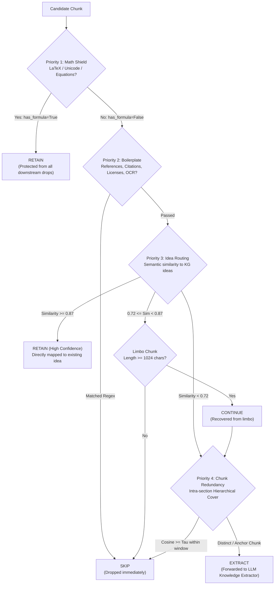

# 🧹 Chunk Filtering & Semantic Redundancy Pruning

`bookeeper` features an intelligent, multi-tier **Stateless Chunk Filtering Conveyor** and **Hierarchical Semantic Cover** engine designed to eliminate non-conceptual noise, discard redundant narrative exposition, and preserve mathematical formulations before sending text chunks to local LLMs (Ollama / vLLM).

Filtering dramatically reduces extraction time, lowers hardware load, avoids duplicate concept pollution, and accelerates graph synthesis—all while maintaining factual fidelity and concept space coverage.

---

## 🏗️ 4-Tier Filtering Architecture & Decision Protocol

The chunk filtering pipeline operates as an ordered conveyor where each candidate chunk is evaluated sequentially against a series of modular filters.



### Three-Tier Decision Protocol (`FilterDecision`)

Every filter in the conveyor returns one of three discrete decisions:
- **`RETAIN`**: Immediately keeps the chunk and halts all further conveyor evaluation. Downstream filters cannot drop this chunk. Used by the **Math Shield** to safeguard theorems and equations.
- **`SKIP`**: Immediately drops the chunk from LLM processing and halts conveyor evaluation. The chunk is marked as skipped in `.book_states/` with the reason recorded.
- **`CONTINUE`**: Passes the chunk along to the next filter in the conveyor. If a chunk reaches the end of the conveyor with `CONTINUE`, it is retained for LLM extraction.

---

## 🛡️ Conveyor Filter Hierarchy

### Priority 1: Mathematical Formula Shield (Highest Priority)
- **`detect_formulas` & `retain_formulas`**:
  - Scans for LaTeX delimiters (`$$...$$`, `$...$`, `\[...\]`, `\(...\)`), Greek symbols, Blackboard bold (`ℝ`, `ℤ`, `ℕ`), tensor operators, summation/integrals (`∑`, `∫`, `∏`), subscripts/superscripts (`x_{ij}`, `W^T`), and formal theorem declarations (`Theorem`, `Lemma`, `Proposition`, `Lipschitz`, `Hessian`).
  - Sets `chunk.has_formula = True`.
  - With `retain_formulas: true`, immediately triggers `FilterDecision.RETAIN`. **Mathematical chunks are never dropped by boilerplate filters, OCR cleaners, or semantic redundancy pruning.**

### Priority 2: Non-Conceptual Boilerplate & Structural Rejection
Rejects non-informational layout and bibliographic noise:
- **`reference_sections`**: Detects top-level sections such as *References*, *Bibliography*, *Works Cited*, *Acknowledgments*, *Author Contributions*, and *Declarations*.
- **`bibliographic`**: Drops raw citation lists, dense author-year brackets (`[1]`, `(Smith et al., 2021)`), DOIs (`10.1145/...`), arXiv identifiers, and conference venue headers (`In Proceedings of...`).
- **`technical_boilerplate`**: Strips C/C++ include guards (`#include <...>`, `#define`, `#ifndef`), open-source license headers (Apache, MIT, GPL, Creative Commons), and website navigation artifacts.
- **`dataset_stimulus`**: Filters benchmark prompt noise, survey Likert scales, and tokenizer artifacts.
- **`diagram_ocr`**: Filters visual table and diagram ASCII/OCR fragmentation (only active if `has_formula == False`).

### Priority 3: Idea Similarity Semantic Routing (Middle Priority)
Routes chunks based on cosine distance against previously extracted Knowledge Graph ideas:
- **Brand New Ideas (`< 0.72`)**: Chunks below the unassigned threshold describe unseen concepts and continue directly to LLM extraction.
- **High-Confidence Reuse (`>= 0.87`)**: Chunks matching existing ideas with extreme similarity are directly attributed to existing concepts, saving LLM calls.
- **Limbo Recovery**: Chunks in the ambiguous middle zone ($[0.72, 0.87)$) are skipped unless they exceed `max_batch_chunk_size` (1,024 characters), ensuring long explanatory passages are not prematurely discarded.

### Priority 4: Chunk Similarity & Hierarchical Semantic Cover (Least Priority)
- **`chunk_similarity` / `hierarchical_semantic_cover`**:
  - Compares adjacent chunks within the **same chapter or section** across a sliding window (`window_size: 3`).
  - Computes cosine similarity between local chunk embeddings.
  - If a narrative chunk exceeds similarity threshold $\tau$ with a recently processed section anchor, it is classified as redundant exposition and pruned.
  - **Shield Invariant**: Chunks shielded by Priority 1 (math) or Priority 3 are strictly exempt from redundancy pruning.

---

## ⚡ Fast Filter Settings Verification (State Cache Preservation)

To enable rapid calibration of filtering thresholds without re-running expensive LLM extractions, `bookeeper` uses a non-destructive state cache:

1. **Pre-Filter Dynamic Evaluation**:
   - `hierarchical_semantic_cover` and the filter conveyor evaluate all candidate chunks dynamically at startup based on your **current** `config.yaml` or CLI arguments.
2. **Extraction Cache Preservation (`cached_extraction`)**:
   - When a chunk was previously processed and is now skipped under a stricter threshold, its prior LLM extraction is safely preserved in `.book_states/` under `cached_extraction`.
   - If you later relax the filter threshold (e.g. going from $\tau = 0.92$ back to $\tau = 0.95$), the chunk is restored with **zero LLM latency** by instantly promoting the cached extraction.
3. **No Redundant Inference**: You can test and benchmark various threshold settings ($\tau = 0.92 \dots 0.96$) in seconds without wiping state or repeating inference.

---

## 📊 Empirical Verification & Benchmark Analysis

Comprehensive empirical evaluation on an 18,233-chunk scientific document corpus demonstrates the performance characteristics across similarity thresholds $\tau \in \{0.92, 0.93, 0.94, 0.95, 0.96, 1.00\}$:

### Master Comparison Matrix

| Metric | $\tau = 0.92$ (Aggressive) | $\tau = 0.93$ | $\tau = 0.94$ | $\tau = 0.95$ (Recommended) | $\tau = 0.96$ (Conservative) | $\tau = 1.00$ (Baseline) |
| :--- | :---: | :---: | :---: | :---: | :---: | :---: |
| **Universe Chunks** | 18,233 | 18,233 | 18,233 | 18,233 | 18,233 | 18,233 |
| **Parent Chunks Extracted** | 9,747 | 10,349 | 10,998 | **11,820** | 13,240 | 14,602 |
| **Skipped Chunks** | 8,486 | 7,884 | 7,235 | **6,413** | 4,993 | 3,631 |
| **Total Skipped %** | **46.54%** | **43.24%** | **39.68%** | **35.17%** | **27.38%** | **19.91%** |
| **Extra Chunks Pruned vs Base** | +4,855 | +4,253 | +3,604 | **+2,782** | +1,362 | 0 |
| **Concept Graph Nodes** | 25,859 | 26,924 | 28,006 | **29,173** | 30,988 | 32,420 |
| **Raw Ideas Extracted** | 11,179 | 11,828 | 12,516 | **13,406** | 14,879 | 16,362 |
| **Chamfer Mean Alignment** | 0.7332 | 0.7347 | 0.7371 | **0.7388** | **0.7407** | **0.7419** |
| **Worst Decile ($p_{10}$)** | 0.6619 | 0.6640 | 0.6666 | **0.6685** | **0.6707** | **0.6709** |
| **Coverage at $\tau = 0.75$** | 38.43% | 39.45% | 40.87% | **42.25%** | **43.77%** | **45.05%** |
| **Vendi Diversity Score** | 8.89 | 8.90 | 8.90 | **8.92** | **8.93** | **8.92** |
| **Skipped Retention ($R_{\text{skipped}}$)** | 26.61% | 26.98% | 27.03% | **27.06%** | 23.88% | 15.65% |

> [!IMPORTANT]
> ### ⚠️ Nominal Pruning Stat vs. Real Skip Rate in Production
> The **Total Skipped / Pruned Chunks %** reported above (e.g. **35.17%** at $\tau = 0.95$ and **27.38%** at $\tau = 0.96$) reflects the **gross theoretical candidate pruning rate** across an entire document corpus.
> 
> In **actual live book ingestion**, the **real skip rate is approximately `gross prune rate - (12% to 13%)`**:
> - At **$\tau = 0.95$**: Real skipped rate during live extraction is **~22% – 23%** (rather than 35%).
> - At **$\tau = 0.96$**: Real skipped rate during live extraction is **~14% – 15%** (rather than 27%).
> - On math-heavy or formula-dense books, real skipped chunks may drop to **~11% – 13%** because:
>   1. **Priority 1 Math Shield**: Any chunk containing equations, LaTeX, or Unicode symbols immediately halts the conveyor with `RETAIN`. Math is never pruned regardless of semantic similarity.
>   2. **Section Anchor Guarantees**: The opening chunk of every chapter and section is unconditionally preserved as a conceptual anchor.
>   3. **Substantive Expansion Guard**: Substantive conceptual expansions ($\ge 500$ chars) cannot be pruned by short preceding headers ($< 300$ chars).

### Key Benchmark Insights

```
                   [Chamfer Mean Cosine]
  0.742 ┤                                        ★ (1.00: 32,420 nodes)
  0.740 ┤                                ◆ (0.96: 30,988 nodes)
  0.738 ┤                       ● (0.95: 29,173 nodes)  <-- Optimal Knee Point
  0.736 ┤              ▲ (0.94: 28,006 nodes)
  0.734 ┤     ■ (0.93: 26,924 nodes)
  0.732 ┤ ▼ (0.92: 25,859 nodes)
        └─────┬──────────┬──────────┬──────────┬──────────┬─────
             46.5%      43.2%      39.7%      35.2%      27.4%   19.9%
                                [Pruning Rate %]
```

1. **The Pareto Optimal Knee is $\tau = 0.95$**:
   - Prunes **35.17% of total chunks** (+2,782 redundant chunks beyond baseline regex filters).
   - Reduces raw LLM workload by **18.1%** and graph node clutter by **10.0%**.
   - Preserves **99.58% of semantic alignment** (Chamfer mean of $0.7388$ vs. $0.7419$, a delta of just $-0.0031$).
   - Reaches the **peak Skipped Retention** ($R_{\text{skipped}} = 27.06\%$), proving that the retained parent chunks maximally represent the pruned material.
2. **The Near-Lossless Boundary is $\tau = 0.96$**:
   - Prunes **27.38% of total chunks** (+1,362 redundant chunks dropped).
   - Retains **99.84% Chamfer Mean** ($0.7407$ vs. $0.7419$) with virtually zero change in the worst-decile floor ($p_{10} = 0.6707$ vs. $0.6709$, $\Delta = -0.0002$).
3. **Semantic Diversity (Vendi Score) is Invariant**:
   - The Vendi score remains between **$8.89$ and $8.93$** across all thresholds. Pruning removes redundant restatements of existing concepts without degrading conceptual diversity.

---

## ⚙️ Recommended Configuration Profiles

### 1. Recommended Production Profile (Optimal Pareto Balance)
Best balance between GPU/LLM throughput, graph compactness, and factual fidelity.

```yaml
# In config.yaml:
filter:
  enabled: true                       # Master switch: enable 4-tier filtering conveyor

  # Priority 1 & 2: Math Shield & Structural Boilerplate
  detect_formulas: true               # Detect math formulas and tag chunk.has_formula
  retain_formulas: true               # Immediately RETAIN math chunks, shielding from drops
  reference_sections: true            # Drop References, Bibliography, Acknowledgments
  bibliographic: true                 # Drop citation lists, DOIs, arXiv headers
  technical_boilerplate: true         # Drop C/C++ headers and open-source licenses
  dataset_stimulus: true              # Drop survey questions and tokenizer noise
  diagram_ocr: true                   # Drop ASCII/OCR diagram fragments (unless math)
  skip_references_sections: true      # Bypass bibliography sections in papers

  # Priority 3: Semantic Idea Routing
  idea_similarity:
    enabled: false                    # Set true when routing against live KG index
    unassigned_threshold: 0.72
    high_confidence_threshold: 0.87
    skip_limbo_chunks: true
    max_batch_chunk_size: 1024

  # Priority 4: Intra-Section Semantic Redundancy Cover
  chunk_similarity:
    enabled: true                     # Enable intra-section semantic redundancy pruning
    threshold: 0.95                   # Optimal Pareto threshold: 35.17% pruned, 99.6% retention
    window_size: 3                    # Compare against preceding 3 section chunks
    min_section_chunks: 2             # Require at least 2 chunks in section before pruning
```

### 2. High-Fidelity / Conservative Profile ($\tau = 0.96$)
Recommended for highly dense mathematical or legal corpora where even minor rephrasings may introduce distinct nuance:

```yaml
filter:
  chunk_similarity:
    enabled: true
    threshold: 0.96                   # Near-lossless: 27.38% pruned, identical p10 floor
    window_size: 3
    min_section_chunks: 2
```

### 3. Aggressive Compression Profile ($\tau = 0.92$)
Recommended for high-throughput batch ingestion of conversational or verbose narrative books:

```yaml
filter:
  chunk_similarity:
    enabled: true
    threshold: 0.92                   # Max throughput: 46.54% pruned, 20% smaller graph
    window_size: 4
    min_section_chunks: 2
```

---

## 💻 CLI Flags & Runtime Overrides

You can override filter behavior dynamically at the command line during `bookeeper build-graph`:

```bash
# Ingest with recommended optimal cover threshold (0.95):
bookeeper build-graph --hierarchical-cover --cover-threshold 0.95 --cover-window 3

# Run conservative near-lossless extraction (0.96):
bookeeper build-graph --hierarchical-cover --cover-threshold 0.96

# Disable intra-section similarity pruning (only run regex boilerplate filters):
bookeeper build-graph --no-hierarchical-cover

# Disable bibliography skipping:
bookeeper build-graph --no-skip-references
```

### Verification & Auditing Commands

To audit whether filtering introduced any conceptual blind spots, run the Knowledge Graph verifier:

```bash
# Verify coverage of bottom-decile chunks and check skipped retention:
bookeeper verify --mode kg --tau 0.75

# Generate frontier-model audit prompt for lowest-p10 tail chunks:
bookeeper verify --mode kg --tau 0.75 --low-p10-prompt
```

---

## 🔗 Related Documentation
- 🏗️ [Building the Knowledge Graph](building-graph.md): Detailed ingestion workflow and semantic routing.
- 🔬 [A/B Testing & Benchmarking](ab-tests.md): Empirical test harness for comparing configurations.
- 🛡️ [Factual Verification & Auditing](verification.md): Factual grounding, Chamfer distance, and low-$p_{10}$ tail audits.
- 🔄 [Recommended Workflow](workflow.md): Complete operational lifecycle.
