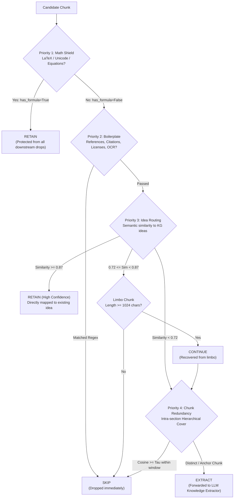

# 🧹 Chunk Filtering & Semantic Redundancy Pruning

`bookeeper` features an intelligent, multi-tier **Stateless Chunk Filtering Conveyor** and **Hierarchical Semantic Cover** engine designed to eliminate non-conceptual noise, discard redundant narrative exposition, and preserve mathematical formulations before sending text chunks to local LLMs (Ollama / vLLM).

Filtering dramatically reduces extraction time, lowers hardware load, avoids duplicate concept pollution, and accelerates graph synthesis—all while maintaining factual fidelity and concept space coverage.

---

## 🏗️ 4-Tier Filtering Architecture & Decision Protocol

The chunk filtering pipeline operates as an ordered conveyor where each candidate chunk is evaluated sequentially against a series of modular filters.



### Three-Tier Decision Protocol (`FilterDecision`)

Every filter in the conveyor returns one of three discrete decisions:
- **`RETAIN`**: Immediately keeps the chunk and halts all further conveyor evaluation. Downstream filters cannot drop this chunk. Used by the **Math Shield** to safeguard theorems and equations.
- **`SKIP`**: Immediately drops the chunk from LLM processing and halts conveyor evaluation. The chunk is marked as skipped in `.book_states/` with the reason recorded.
- **`CONTINUE`**: Passes the chunk along to the next filter in the conveyor. If a chunk reaches the end of the conveyor with `CONTINUE`, it is retained for LLM extraction.

---

## 🛡️ Conveyor Filter Hierarchy

### Priority 1: Mathematical Formula Shield (Highest Priority)
- **`detect_formulas` & `retain_formulas`**:
  - Pre-strips URLs (e.g. `openreview.net/forum?id=...`) and currency amounts (`$0.10`, `$1`) before scanning for LaTeX delimiters (`$$...$$`, `$...$`, `\[...\]`, `\(...\)`), Greek symbols, Blackboard bold (`ℝ`, `ℤ`, `ℕ`), tensor operators, summation/integrals (`∑`, `∫`, `∏`), subscripts/superscripts (`x_{ij}`, `W^T`), and formal theorem declarations (`Theorem`, `Lemma`, `Proposition`, `Lipschitz`, `Hessian`).
  - Applies a weak-symbol bibliography guard (`′`, `″`, `∼`, `×`, `⋅`, `°`, `…`) so reference chunks with prime or tilde characters in paper titles are not falsely shielded as math.
  - Sets `chunk.has_formula = True`.
  - With `retain_formulas: true`, immediately triggers `FilterDecision.RETAIN`. **Mathematical chunks are never dropped by boilerplate filters, OCR cleaners, or semantic redundancy pruning.**

### Priority 2: Non-Conceptual Boilerplate & Structural Rejection
Rejects non-informational layout and bibliographic noise strictly **before** `IdeaSimilarityFilter` and `ChunkSimilarityFilter`:
- **`reference_sections`**: Detects top-level and inline sections such as *References*, *Bibliography*, *Works Cited*, *Acknowledgments*, *Author Contributions*, *AI Use / Disclosure Statements*, *Reproducibility / Ethics Statements*, short (`< 320` chars) funding/grant disclosures, NeurIPS/ICLR paper checklists, and Table of Contents leader dots (`. . . . 24`). Also tracks constrained document-order reference continuations across PDF `"Pages X-Y"` chunks while immediately exiting upon encountering math formulas, `Appendix`/`Supplementary` headings, or conceptual prose.
- **`bibliographic`**: Drops raw citation lists, dense author-year brackets (`[1]`, `(Smith et al., 2021)`), DOIs (`10.1145/...`), arXiv identifiers, OpenReview/ACL/PMLR URLs, conference venue headers (`In Proceedings of...`, `In Findings of...`), and short (`< 280` chars) multi-author / venue citation slices that lack `Concept: Subtitle` definitions.
- **`technical_boilerplate`**: Strips C/C++ include guards (`#include <...>`, `#define`, `#ifndef`), open-source license headers (Apache, MIT, GPL, Creative Commons), short (`< 300` chars) title/author affiliation blocks (`Correspondence to:`, institutional superscripts), and website navigation artifacts.
- **`dataset_stimulus`**: Filters benchmark tokenizer noise (`@-@`, `<unk>`), verbatim chat prompt wrappers (`<|im_start|>...<|im_end|>`, `<curr_prompt>`), short (`< 400` chars) JSON verification schemas, dense VQA question dumps (`>= 4` questions in `< 150` chars), and survey Likert scales.
- **`diagram_ocr`**: Filters visual table and diagram ASCII/OCR fragmentation, checkmark/cross comparison matrices (`✓ ✓ × ×`), and numbered diagram callout lists (`01 ... 02 ... 03 ... 04 ...`) when `has_formula == False`.
- **`captions_and_signposts`**: Filters short standalone `Figure`/`Table`/`Listing` captions (`< 140` chars without explanatory prose verbs), subfigure label blocks (`(a) ... (b) ... < 200` chars), and short cross-reference signpost chunks (`< 160` chars, e.g. *"All proofs are provided in Appendix B"*) when `has_formula == False`.

### Priority 3: Idea Similarity Semantic Routing (Middle Priority)
Routes chunks based on cosine distance against previously extracted Knowledge Graph ideas:
- **Brand New Ideas (`< 0.72`)**: Chunks below the unassigned threshold describe unseen concepts and continue directly to LLM extraction.
- **High-Confidence Reuse (`>= 0.87`)**: Chunks matching existing ideas with extreme similarity are directly attributed to existing concepts, saving LLM calls.
- **Limbo Recovery**: Chunks in the ambiguous middle zone ($[0.72, 0.87)$) are skipped unless they exceed `max_batch_chunk_size` (1,024 characters), ensuring long explanatory passages are not prematurely discarded.

### Priority 4: Chunk Similarity & Hierarchical Semantic Cover (Least Priority)
- **`chunk_similarity` / `hierarchical_semantic_cover`**:
  - Compares adjacent chunks within the **same chapter or section** across a sliding window (`window_size: 3`).
  - Computes cosine similarity between local chunk embeddings.
  - If a narrative chunk exceeds similarity threshold $\tau$ with a recently processed section anchor, it is classified as redundant exposition and pruned.
  - **Shield Invariant**: Chunks shielded by Priority 1 (math) or Priority 3 are strictly exempt from redundancy pruning.

---

## ⚡ Fast Filter Settings Verification (State Cache Preservation)

To enable rapid calibration of filtering thresholds without re-running expensive LLM extractions, `bookeeper` uses a non-destructive state cache:

1. **Pre-Filter Dynamic Evaluation**:
   - `hierarchical_semantic_cover` and the filter conveyor evaluate all candidate chunks dynamically at startup based on your **current** `config.yaml` or CLI arguments.
2. **Extraction Cache Preservation (`cached_extraction`)**:
   - When a chunk was previously processed and is now skipped under a stricter threshold, its prior LLM extraction is safely preserved in `.book_states/` under `cached_extraction`.
   - If you later relax the filter threshold (e.g. going from $\tau = 0.92$ back to $\tau = 0.95$), the chunk is restored with **zero LLM latency** by instantly promoting the cached extraction.
3. **No Redundant Inference**: You can test and benchmark various threshold settings ($\tau = 0.92 \dots 0.96$) in seconds without wiping state or repeating inference.

---

## 📊 Empirical Verification & Benchmark Analysis

Comprehensive empirical evaluation on an 18,233-chunk scientific document corpus demonstrates the performance characteristics across similarity thresholds $\tau \in \{0.92, 0.93, 0.94, 0.95, 0.96, 1.00\}$:

### Master Comparison Matrix

| Metric | $\tau = 0.92$ (Aggressive) | $\tau = 0.93$ | $\tau = 0.94$ | $\tau = 0.95$ (Recommended) | $\tau = 0.96$ (Conservative) | $\tau = 1.00$ (Baseline) |
| :--- | :---: | :---: | :---: | :---: | :---: | :---: |
| **Universe Chunks** | 18,233 | 18,233 | 18,233 | **18,233** | 18,233 | 18,233 |
| **Parent Chunks Extracted** | 10,987 | 11,535 | 12,139 | **12,898** | 14,282 | 16,084 |
| &nbsp;&nbsp;├─ *Retained Chunks (Math / Shield)* | 3,335 | 3,335 | 3,335 | **3,335** | 3,335 | 3,335 |
| &nbsp;&nbsp;└─ *Continued Chunks (LLM Extracted)* | 7,652 | 8,200 | 8,804 | **9,563** | 10,947 | 12,749 |
| **Skipped Chunks** | 7,246 | 6,698 | 6,094 | **5,335** | 3,951 | 2,149 |
| **Total Skipped %** | **39.74%** | **36.74%** | **33.42%** | **29.26%** | **21.67%** | **11.79%** |
| **Extraction Compute Ratio ($\rho_{\text{parent}}$)** | 68.68% | 71.65% | 74.89% | **78.68%** | 84.74% | 92.71% |
| **Extra Chunks Pruned vs Base** | +5,097 | +4,549 | +3,945 | **+3,186** | +1,802 | 0 |
| **Concept Graph Nodes** | 26,395 | 27,305 | 28,269 | **29,325** | 30,977 | 32,983 |
| **Raw Ideas Extracted** | 11,457 | 12,027 | 12,656 | **13,454** | 14,835 | 16,670 |
| **Chamfer Mean Alignment** | 0.7341 | 0.7357 | 0.7376 | **0.7390** | **0.7407** | **0.7421** |
| **Worst Decile ($p_{10}$)** | 0.6634 | 0.6651 | 0.6669 | **0.6681** | **0.6698** | **0.6713** |
| **Coverage at $\tau = 0.75$** | 39.03% | 40.05% | 41.23% | **42.44%** | **43.82%** | **45.09%** |
| **Vendi Diversity Score** | 8.90 | 8.91 | 8.91 | **8.93** | **8.93** | **8.93** |
| **Skipped Retention ($R_{\text{skipped}}$)** | 29.49% | 29.89% | 29.63% | **29.40%** | 24.85% | 10.76% |

### Live Conveyor Execution & Chunk Accounting

All figures in the Master Comparison Matrix reflect **actual live execution metrics** recorded directly into the Knowledge Graph via the discrete `filter_state` attribute (`skip`, `retain`, `continue`) on each Chunk node:

1. **Priority 1 Math Shield Invariant (`filter_state: retain`)**:
   - Exactly **3,335 chunks (18.29% of the corpus)** contain mathematical formulations, equations, LaTeX notation, or formal theorem declarations.
   - These chunks unconditionally trigger `FilterDecision.RETAIN` at Priority 1 and are **100% shielded from downstream pruning**, ensuring mathematical and quantitative knowledge is preserved regardless of how aggressive semantic redundancy pruning is set.
2. **LLM Extraction Conveyor (`filter_state: continue`)**:
   - Chunks that clear all structural boilerplate filters and fall below the similarity pruning threshold $\tau$ are forwarded to local LLM workers for idea extraction.
   - At $\tau = 0.95$, LLM chunk evaluations drop from **12,749 down to 9,563**—an immediate **25.0% reduction in LLM inference load**.
3. **Redundancy & Structural Pruning (`filter_state: skip`)**:
   - Baseline regex filters (Priority 2) prune **2,149 noise chunks (11.79%)** consisting of bibliography, citation brackets, licenses, OCR fragmentation, and table captions.
   - The Hierarchical Semantic Cover engine (Priority 4) safely prunes up to **+3,186 additional redundant narrative chunks** at $\tau = 0.95$ (**29.26% total corpus chunks skipped**).
4. **Size-Weighted Compute Volume ($\rho_{\text{parent}}$)**:
   - The extraction compute ratio ($\rho_{\text{parent}} = \frac{W_{\text{parent}}}{W_{\text{total}}}$) calculates the actual character volume processed versus total corpus volume.
   - At $\tau = 0.95$, $\rho_{\text{parent}} = 78.68\%$, saving **21.32% of total corpus character/token volume**.

### Key Benchmark Insights

```
                   [Chamfer Mean Cosine]
  0.742 ┤                                        ★ (1.00: 32,983 nodes)
  0.740 ┤                                ◆ (0.96: 30,977 nodes)
  0.739 ┤                       ● (0.95: 29,325 nodes)  <-- Optimal Knee Point
  0.737 ┤              ▲ (0.94: 28,269 nodes)
  0.735 ┤     ■ (0.93: 27,305 nodes)
  0.734 ┤ ▼ (0.92: 26,395 nodes)
        └─────┬──────────┬──────────┬──────────┬──────────┬─────
             39.7%      36.7%      33.4%      29.3%      21.7%   11.8%
                                [Pruning Rate %]
```

1. **The Pareto Optimal Knee is $\tau = 0.95$**:
   - Prunes **29.26% of total corpus chunks** (+3,186 redundant chunks beyond baseline regex filters).
   - Decreases LLM extraction inference by **25.0%** (9,563 vs. 12,749 chunks) and eliminates **11.1% of graph node clutter** (29,325 vs. 32,983 nodes).
   - Preserves **99.58% of global semantic alignment** (Chamfer mean of $0.7390$ vs. $0.7421$, a minor delta of $-0.0031$).
   - Maximizes **Skipped Retention** ($R_{\text{skipped}} = 29.40\%$ vs. $10.76\%$ at baseline), demonstrating that retained parent chunks strongly encompass the semantics of the skipped material.
2. **The Near-Lossless Boundary is $\tau = 0.96$**:
   - Prunes **21.67% of total chunks** (+1,802 redundant chunks pruned).
   - Retains **99.81% Chamfer Mean** ($0.7407$ vs. $0.7421$) with an imperceptible shift in the worst-decile floor ($p_{10} = 0.6698$ vs. $0.6713$, $\Delta = -0.0015$).
3. **Semantic Diversity (Vendi Score) is Invariant**:
   - The Vendi score remains between **$8.90$ and $8.93$** across all thresholds from $\tau = 0.92$ to $\tau = 1.00$. Pruning removes redundant restatements of existing concepts without reducing conceptual breadth or vocabulary coverage.

---

## ⚙️ Recommended Configuration Profiles

### 1. Recommended Production Profile (Optimal Pareto Balance)
Best balance between GPU/LLM throughput, graph compactness, and factual fidelity.

```yaml
# In config.yaml:
filter:
  enabled: true                       # Master switch: enable 4-tier filtering conveyor

  # Priority 1 & 2: Math Shield & Structural Boilerplate
  detect_formulas: true               # Detect math formulas and tag chunk.has_formula
  retain_formulas: true               # Immediately RETAIN math chunks, shielding from drops
  reference_sections: true            # Drop References, Bibliography, Acknowledgments
  bibliographic: true                 # Drop citation lists, DOIs, arXiv headers
  technical_boilerplate: true         # Drop C/C++ headers and open-source licenses
  dataset_stimulus: true              # Drop survey questions, prompt schemas, and VQA question dumps
  diagram_ocr: true                   # Drop ASCII/OCR diagram fragments and checkmark matrices (unless math)
  captions_and_signposts: true        # Drop standalone Figure/Table captions and short Appendix signposts
  skip_references_sections: true      # Bypass bibliography sections in papers

  # Priority 3: Semantic Idea Routing
  idea_similarity:
    enabled: false                    # Set true when routing against live KG index
    unassigned_threshold: 0.72
    high_confidence_threshold: 0.87
    skip_limbo_chunks: true
    max_batch_chunk_size: 1024

  # Priority 4: Intra-Section Semantic Redundancy Cover
  chunk_similarity:
    enabled: true                     # Enable intra-section semantic redundancy pruning
    threshold: 0.95                   # Optimal Pareto threshold: 29.26% pruned, 99.6% retention
    window_size: 3                    # Compare against preceding 3 section chunks
    min_section_chunks: 2             # Require at least 2 chunks in section before pruning
```

### 2. High-Fidelity / Conservative Profile ($\tau = 0.96$)
Recommended for highly dense mathematical or legal corpora where even minor rephrasings may introduce distinct nuance:

```yaml
filter:
  chunk_similarity:
    enabled: true
    threshold: 0.96                   # Near-lossless: 21.67% pruned, identical p10 floor
    window_size: 3
    min_section_chunks: 2
```

### 3. Aggressive Compression Profile ($\tau = 0.92$)
Recommended for high-throughput batch ingestion of conversational or verbose narrative books:

```yaml
filter:
  chunk_similarity:
    enabled: true
    threshold: 0.92                   # Max throughput: 39.74% pruned, 20% smaller graph
    window_size: 4
    min_section_chunks: 2
```

---

## 💻 CLI Flags & Runtime Overrides

You can override filter behavior dynamically at the command line during `bookeeper build-graph`:

```bash
# Ingest with recommended optimal cover threshold (0.95):
bookeeper build-graph --hierarchical-cover --cover-threshold 0.95 --cover-window 3

# Run conservative near-lossless extraction (0.96):
bookeeper build-graph --hierarchical-cover --cover-threshold 0.96

# Disable intra-section similarity pruning (only run regex boilerplate filters):
bookeeper build-graph --no-hierarchical-cover

# Disable bibliography skipping:
bookeeper build-graph --no-skip-references
```

### Verification & Auditing Commands

To audit whether filtering introduced any conceptual blind spots, run the Knowledge Graph verifier:

```bash
# Verify coverage of bottom-decile chunks and check skipped retention:
bookeeper verify --mode kg --tau 0.75

# Generate frontier-model audit prompt for lowest-p10 tail chunks:
bookeeper verify --mode kg --tau 0.75 --low-p10-prompt
```

---

## 🔗 Related Documentation
- 🏗️ [Building the Knowledge Graph](building-graph.md): Detailed ingestion workflow and semantic routing.
- 🔬 [A/B Testing & Benchmarking](ab-tests.md): Empirical test harness for comparing configurations.
- 🛡️ [Factual Verification & Auditing](verification.md): Factual grounding, Chamfer distance, and low-$p_{10}$ tail audits.
- 🔄 [Recommended Workflow](workflow.md): Complete operational lifecycle.
