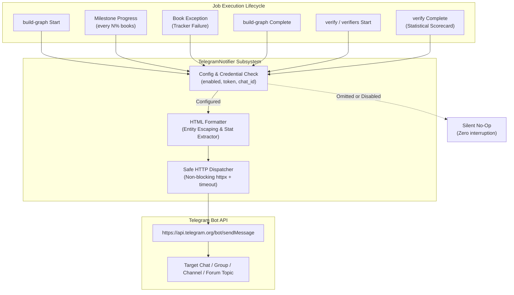

# 📬 Telegram Notifications Subsystem

Bookkeeper includes a production-grade Telegram notification engine that dispatches real-time alerts and progress milestones directly to your Telegram chat, group, or forum supergroup topic during **Knowledge Graph building** and **Factual Verification audits**.

Notifications are enabled by default and operate with graceful, non-blocking failover: if credentials are omitted or network connectivity drops, notifications quietly skip without interrupting your jobs.

---

## 📋 Table of Contents

- [1. Overview & Architecture](#1-overview--architecture)
- [2. Configuration](#2-configuration)
  - [YAML Configuration (`config.yaml` & `my-config.yaml`)](#yaml-configuration-configyaml--my-configyaml)
  - [Environment Variables](#environment-variables)
- [3. Knowledge Graph Build Notifications (`build-graph`)](#3-knowledge-graph-build-notifications-build-graph)
  - [Pipeline Start Alert](#pipeline-start-alert)
  - [Milestone Progress Updates](#milestone-progress-updates)
  - [Book Failure Warnings](#book-failure-warnings)
  - [Pipeline Completion Summary](#pipeline-completion-summary)
- [4. Verification Notifications (`verify` & `verifiers`)](#4-verification-notifications-verify--verifiers)
  - [Audit Start Alert](#audit-start-alert)
  - [Audit Completion Scorecard](#audit-completion-scorecard)
- [5. Telegram Bot Setup Guide](#5-telegram-bot-setup-guide)
  - [Step 1: Create Bot via @BotFather](#step-1-create-bot-via-botfather)
  - [Step 2: Obtain your Chat ID](#step-2-obtain-your-chat-id)
  - [Step 3 (Optional): Supergroup Topics & Thread IDs](#step-3-optional-supergroup-topics--thread-ids)
- [6. Fault-Tolerance & Reliability Invariants](#6-fault-tolerance--reliability-invariants)

---

## 1. Overview & Architecture

Long-running jobs such as indexing large digital libraries, ingesting multi-volume book collections, or executing deep verification audits can take tens of minutes or hours. The Telegram notification engine keeps you informed without requiring you to monitor terminal output.



---

## 2. Configuration

### YAML Configuration (`config.yaml` & `my-config.yaml`)

Add or adjust the `telegram:` section at the end of your `config.yaml` or personal overlay (`my-config.yaml`):

```yaml
# ==============================================================================
# Telegram Notifications Configuration
# ==============================================================================
telegram:
  enabled: true                       # Master toggle (default: true)
  bot_token: "123456789:ABCDefGhIJKlmNoPQRsTUVwxyZ"  # Bot token from @BotFather
  chat_id: "987654321"                # User ID, Group ID (-100...), or @channelname
  message_thread_id: null             # Optional forum supergroup topic ID
  notify_build_graph: true            # Notify for knowledge graph build start, progress, and completion
  notify_verification: true           # Notify for verification audits (start, completion, and stats)
  progress_step_percent: 10           # Notify every N% during graph build (e.g. 10 for every 10%, 20 for 20%)
  timeout_seconds: 10.0               # Telegram API HTTP timeout in seconds
```

### Environment Variables

You can also configure or override settings dynamically using environment variables without modifying configuration files:

| Environment Variable | Description | Example |
| :--- | :--- | :--- |
| `TELEGRAM_BOT_TOKEN` | Bot API token from `@BotFather` | `123456789:ABC...` |
| `TELEGRAM_CHAT_ID` | Target user ID, group ID, or channel | `987654321` or `-1001234567890` |
| `TELEGRAM_MESSAGE_THREAD_ID` | Forum supergroup topic ID | `42` |
| `TELEGRAM_PROGRESS_STEP` | Milestone progress interval (%) | `10` or `20` |
| `TELEGRAM_ENABLED` | Master toggle (`true`/`false`) | `true` |

*(Note: `BOOKEEPER_TELEGRAM_*` variants are also supported).*

---

## 3. Knowledge Graph Build Notifications (`build-graph`)

### Pipeline Start Alert

Dispatched immediately when `bookeeper build-graph` starts, summarizing the run parameters:

```html
🚀 Knowledge Graph Build Started

📚 Books to process: 60
🧠 LLM Model: qwen2.5:7b-instruct-q4_K_M
⚡ Embeddings: jepa-768
⚙️ Concurrency: 4 worker task(s)
🎯 Target: 60 book(s)
```

### Milestone Progress Updates

Dispatched dynamically whenever catalog progress crosses each configured percentage milestone (configured by `progress_step_percent: 10` for every 10%, or `20` for every 20%):

```html
📊 Knowledge Graph Build Progress: 20%

📚 Books: 12 / 60
📖 Current: Reflective Formalization Evolution for Geometry Problem Solving
⏱ Elapsed: 14m 20s | ETA: 52m 10s
🧩 Chunks: 1,480 assigned, 185 skipped
```

### Book Failure Warnings

Dispatched if a book encounters an unrecoverable exception or schema parsing error during indexing:

```html
⚠️ Book Processing Failed

📖 Book #5854: GeoReform: Reflective Formalization Evolution
❌ Error: ValueError: Missing mandatory section boundary
```

### Pipeline Completion Summary

Dispatched upon final persistence and graph export, providing high-level performance and topological metrics:

```html
✅ Knowledge Graph Build Completed

⏱ Total Duration: 1h 08m 42s
📚 Books Processed: 60 / 60 (Failed: 0)
🧩 Chunks: 7,420 assigned | 920 skipped
🌐 Graph Topology: 4,520 nodes | 12,840 edges
📁 Destination: output/knowledge_graph.json
```

---

## 4. Verification Notifications (`verify` & `verifiers`)

### Audit Start Alert

Dispatched on initiation of any verification mode (`ideas`, `chunk`, `cross-check`, `graph`/`kg`, or `drift`):

```html
🔍 Verification Started (IDEAS)

🎯 Mode: ideas
🧠 Model: gemma4:12b
🎯 Target: output/knowledge_graph.json
📋 Sample: 3.0% sample
```

### Audit Completion Scorecard

Dispatched upon completion of the verification audit with high-level statistical evaluation metrics:

```html
✅ Verification Finished (IDEAS)

🎯 Mode: ideas
🧠 Model: gemma4:12b
⏱ Duration: 42s

📊 Summary Statistics:
  • Calibrated Fidelity: 94.50%
  • Factual Recall: 98.20%
  • Net Semantic Integrity: +0.92
  • Hallucination Rate: 1.80%
  • Sample Size: 25 item(s)
  • Discrepancies: 1
```

For graph space audits (`--mode graph` / `kg`), coverage and topological diversity are reported:
```html
📊 Summary Statistics:
  • Graph Coverage (τ): 92.40%
  • Vendi Diversity: 4.120
  • Sample Size: 120 item(s)
```

---

## 5. Telegram Bot Setup Guide

### Step 1: Create Bot via @BotFather
1. Open Telegram and search for `@BotFather`.
2. Send `/newbot`.
3. Choose a name and a username for your bot (e.g. `MyBookeeperBot`).
4. Copy the HTTP API token provided by BotFather (format: `123456789:ABCDefGhIJKlmNoPQRsTUVwxyZ`).

### Step 2: Obtain your Chat ID
- **Direct Messages**: Message `@userinfobot` or `@RawDataBot` in Telegram to see your numeric `id` (e.g. `987654321`).
- **Group Chats**:
  1. Add your bot to the target group.
  2. Send a test message in the group mentioning the bot.
  3. Query `https://api.telegram.org/bot<YOUR_TOKEN>/getUpdates` in your browser.
  4. Look for `"chat":{"id": -100xxxxxxxxxx}`. Group IDs always start with a minus sign (often `-100`).

### Step 3 (Optional): Supergroup Topics & Thread IDs
If you are sending messages to a specific forum topic inside a Telegram supergroup:
1. Right-click or long-press the topic title in Telegram and copy the link (e.g. `https://t.me/c/1234567890/42`).
2. The last number (`42`) is your `message_thread_id`.
3. Set `message_thread_id: 42` in `config.yaml`.

---

## 6. Fault-Tolerance & Reliability Invariants

1. **Non-Blocking Execution**: Telegram notifications run with strict timeouts (`timeout_seconds: 10.0`). Slow network responses will never stall or delay book indexing tasks.
2. **Crash Prevention**: All network errors, timeouts, invalid token formats, or rate limits (`HTTP 429`) are caught and logged at debug/warning levels. They **never raise unhandled exceptions** or interrupt running jobs.
3. **Automatic Content Truncation**: Telegram enforces a hard 4,096-character limit per message. The notifier automatically truncates and appends `[... truncated]` if book titles or error strings exceed the boundary.
4. **HTML Entity Escaping**: Dynamic titles, mathematical expressions, author names, and exception messages are passed through `html.escape()` to prevent Telegram API HTML parse errors.
