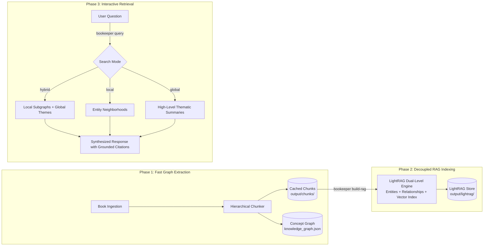

# 🔍 Decoupled Hybrid RAG (Retrieval-Augmented Generation)

Bookkeeper integrates a dual-level graph and vector retrieval engine powered by **LightRAG**. It combines local entity knowledge subgraphs with high-level thematic vector summaries to deliver context-aware, halluncination-resistant answers across your entire digital book library.

---

## 📋 Table of Contents

- [1. Decoupled Architecture](#1-decoupled-architecture)
- [2. Why Decouple Extraction from RAG Indexing?](#2-why-decouple-extraction-from-rag-indexing)
- [3. Indexing Chunks (`build-rag`)](#3-indexing-chunks-build-rag)
- [4. Querying the Library (`query`)](#4-querying-the-library-query)
  - [Query Modes](#query-modes)
  - [Examples](#examples)
- [5. Configuration Options](#5-configuration-options)
- [6. Next Steps](#6-next-steps)

---

## 1. Decoupled Architecture



---

## 2. Why Decouple Extraction from RAG Indexing?

During early versions of Bookkeeper, running heavy LightRAG vector embedding and entity-relation extraction concurrently with book ingestion created serious bottlenecks:
1. **Model Swapping Latency**: Ollama repeatedly unloaded the LLM to load the embedding model and vice versa, destroying batch throughput.
2. **Single Point of Failure**: A stalled chunk or memory pressure in LightRAG could disrupt knowledge graph extraction midway through a multi-book library.

**The Solution:**
- **`build-graph --no-lightrag`**: Ingests books, generates persistent hierarchical chunks in `output/chunks/`, and builds the NetworkX knowledge graph at maximum speed.
- **`build-rag`**: Reads pre-parsed, cached chunks directly from SSD and indexes them into LightRAG independently, allowing dedicated GPU batching or overnight execution.

---

## 3. Indexing Chunks (`build-rag`)

Once you have ingested books and generated chunk files, index them into LightRAG:

```bash
# Index all locally cached chunks from output/chunks/ into LightRAG:
bookeeper build-rag

# Rebuild LightRAG database cleanly from scratch:
bookeeper build-rag --clean

# Index chunks for a specific book only:
bookeeper build-rag --book-id 42

# Index using a custom LightRAG working directory:
bookeeper build-rag --lightrag-dir ./output/custom_lightrag
```

**What Happens During Indexing:**
- Chunks stored in `output/chunks/book_<id>_chunk_<idx>.json` are streamed into LightRAG.
- Generates low-level entity and relationship graph nodes.
- Generates high-level community summaries for global thematic retrieval.
- Embeds text chunks via `nomic-embed-text` into the local vector index.

---

## 4. Querying the Library (`query`)

The `bookeeper query` command provides an interactive question-answering interface against your indexed LightRAG database.

### Query Modes

LightRAG supports multiple retrieval modes tailored to the specificity of your query:

| Mode | Flag | Best Suited For | How It Works |
| :--- | :--- | :--- | :--- |
| **Hybrid** *(Default)* | `--mode hybrid` | General architectural questions, complex multi-part queries | Combines local entity subgraphs with global thematic community summaries. |
| **Local** | `--mode local` | Specific concepts, characters, mechanisms, definitions | Retrieves the 1-2 hop neighborhood around specific entities and chunks. |
| **Global** | `--mode global` | Broad thematic questions, cross-book trends, overarching summaries | Searches high-level community clusters and global themes without local trivia. |
| **Naive** | `--mode naive` | Baseline comparisons | Standard vector similarity search against raw chunks without graph traversal. |

### Examples

```bash
# 1. Hybrid Search (Default - Recommended for most technical queries):
bookeeper query "What are the core consensus mechanisms and tradeoffs in Paxos versus Raft?"

# 2. Local Entity Search:
bookeeper query "How does Write-Ahead Logging prevent corruption during sudden power loss?" --mode local

# 3. Global Thematic Search:
bookeeper query "What are the overarching architectural patterns for data consistency discussed across all books?" --mode global

# 4. Standard Vector Baseline:
bookeeper query "Explain the two-phase commit protocol." --mode naive
```

---

## 5. Configuration & Performance Tuning

Configure LightRAG settings and throughput concurrency in `config.yaml`:

```yaml
# Enable or disable automatic LightRAG indexing during build-graph:
enable_lightrag: true

# Working directory for LightRAG graph and vector indices:
lightrag_dir: "output/lightrag"

# LLM and Embedding models for LightRAG:
llm_model: "qwen2.5:7b-instruct-q4_K_M"
embedding_model: "bge-m3:latest"
lightrag_embedding_dim: 1024

# --- Throughput & Concurrency Tuning ---
lightrag_max_parallel_insert: 6     # Number of documents/chunks parsed in parallel (default: 6)
lightrag_llm_max_async: 16          # Max concurrent entity/relation extraction calls to Ollama (default: 16)
lightrag_embedding_batch_num: 64    # Number of text chunks sent in a single batch to embedding endpoint (default: 64)
lightrag_embedding_max_async: 32    # Concurrent async embedding workers (default: 32)
lightrag_ollama_keep_alive: "-1"    # Keeps models permanently pinned in RAM/VRAM to prevent unload thrashing
```

### Preventing Ollama VRAM/RAM Thrashing
If your LLM and embedding model share the same Ollama server instances, configure the following on your Ollama host:
```bash
export OLLAMA_MAX_LOADED_MODELS=3
export OLLAMA_NUM_PARALLEL=4
```
Combined with `lightrag_ollama_keep_alive: "-1"`, this keeps weights permanently mapped into GPU/system memory and avoids model unload/reload thrashing during heavy ingestion.

### Live Progress Bar & Status
When indexing with `bookeeper build-rag`, Bookkeeper renders a live Rich progress bar tracking both overall books and individual chunk batches with active ETAs, elapsed time, and completion percentages.


---

## 6. Next Steps

- 🏗️ **[Building the Knowledge Graph](building-graph.md)** — Manage book ingestion, chunk caches, and graph exports.
- 🧪 **[Two-Pass Idea Post-Processing (Experimental POC)](post-processing.md)** — Second-pass entity clustering and synthesis.
- 🛡️ **[Factual Verification & Auditing](verification.md)** — Auditing factual grounding and chunk coherence.
- 🏠 **[Return to Documentation Index](../README.md)**
