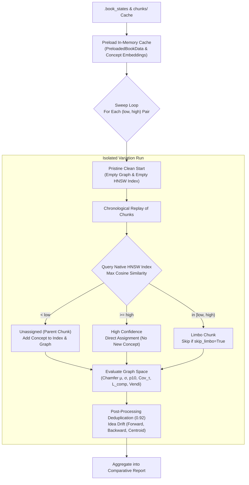
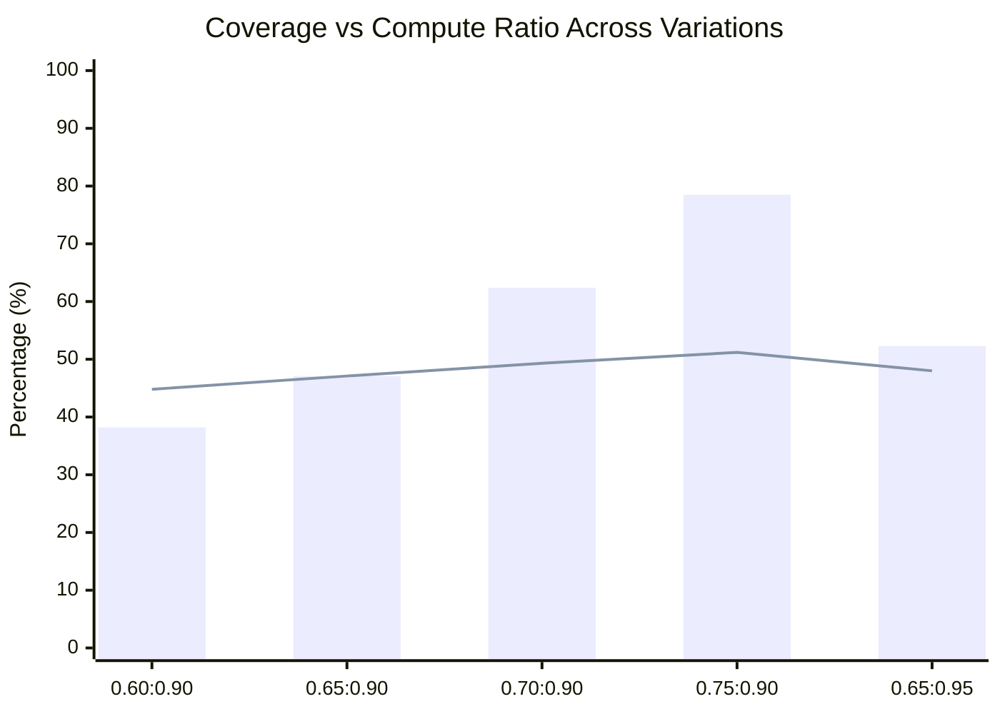

# ⚡ Knowledge Base Threshold Simulator & Sweep Engine

The **Threshold Simulator** enables ultra-fast, offline simulation of semantic chunk routing, knowledge graph growth, and post-processing quality across dozens of `(low, high)` threshold pairs.

By replaying pre-extracted concepts and cached chunk vectors through an in-memory native C++ [usearch](https://github.com/unum-cloud/usearch) HNSW index, Bookkeeper simulates variations at native speed (**<0.2 seconds per variation**) without making any redundant LLM calls.

---

## 📋 Table of Contents

- [1. Motivation & Problem Statement](#1-motivation--problem-statement)
- [2. How Threshold Simulation Works](#2-how-threshold-simulation-works)
  - [Chunk Routing Logic](#chunk-routing-logic)
  - [Post-Processing Step & Drift Calculation](#post-processing-step--drift-calculation)
  - [Pristine State Isolation](#pristine-state-isolation)
- [3. CLI Usage & Flags](#3-cli-usage--flags)
  - [Running a Threshold Sweep](#running-a-threshold-sweep)
  - [Available Command Flags](#available-command-flags)
- [4. Interpreting Simulation Output](#4-interpreting-simulation-output)
  - [Terminal Table](#terminal-table)
  - [Markdown Report & Mermaid Plots](#markdown-report--mermaid-plots)
- [5. Calibrating Production Settings](#5-calibrating-production-settings)

---

## 1. Motivation & Problem Statement

When building a Knowledge Graph from literature, two semantic similarity thresholds govern how chunks are processed:
1. **Low Threshold (`threshold_unassigned`, e.g. 0.65)**: Below this score, incoming text is considered novel, triggering LLM concept extraction.
2. **High Threshold (`threshold_high_confidence`, e.g. 0.90)**: At or above this score, incoming text matches an existing idea with high confidence, assigning it directly without new concept extraction.
3. **Limbo Zone (`[low, high)`)**: Chunks with intermediate similarity that may either be skipped or extracted.

Finding the optimal threshold pair involves balancing two opposing forces:
* **Over-extraction (Low threshold too low)**: Exploding graph size, duplicate concepts, and excessive LLM compute.
* **Under-extraction (Low threshold too high)**: Missing unique concepts, causing severe blind spots and semantic loss.

Running full indexing passes with LLMs to test thresholds takes hours or days. The Threshold Simulator tests 5–10 pairs in **under 2 seconds**.

---

## 2. How Threshold Simulation Works



### Chunk Routing Logic
1. Replays preloaded books in exact chronological publication order.
2. For each chunk, queries the active in-memory HNSW vector index for the top-1 nearest neighbor concept.
3. Routes the chunk:
   * **$< \text{low}$**: Mark chunk as parent, load genuine extracted concept vectors from state cache, and insert into graph and vector index.
   * **$\ge \text{high}$**: High-confidence match; record assignment without adding concepts.
   * **$[\text{low}, \text{high})$**: Limbo chunk; bypassed when `--skip-limbo` is enabled.

### Post-Processing Step & Drift Calculation
When `--postprocess` is enabled (default: `True`):
1. **Semantic Deduplication**: Applies greedy clustering with `--postprocess-threshold` (default `0.92`) to merge near-duplicate idea vectors.
2. **Post-Processing Idea Drift Metrics**:
   * **Forward Retention ($S_{R \to P}$)**: Proximity of surviving post ideas to original raw ideas.
   * **Backward Fidelity ($S_{P \to R}$)**: Verification that merged ideas remain faithful to raw statements.
   * **Centroid Cosine Alignment**: Macro topic drift between raw and post spaces.
   * **Tail Risk ($p_{10}$)** & **Dropped Raw Count** ($< \tau_{\text{loss}}$).

### Pristine State Isolation
To prevent cross-variation state contamination, the simulator enforces a strict clean-start invariant:
* Allocates a brand-new `ConceptGraphStore` and `IdeaEmbeddingIndex` for each variation.
* Asserts 0 nodes and 0 vectors before starting.
* Forcefully purges index pointers and triggers garbage collection after each variation.

---

## 3. CLI Usage & Flags

### Running a Threshold Sweep

```bash
# Run simulation across default threshold pairs (0.60:0.90, 0.65:0.90, 0.70:0.90, 0.75:0.90, 0.65:0.95):
bookeeper simulate-thresholds

# Alias command:
bookeeper sweep-thresholds -p "0.65:0.90,0.70:0.90,0.75:0.95"

# Run sweep without post-processing step:
bookeeper simulate-thresholds --no-postprocess

# Customize evaluation radius and save report:
bookeeper simulate-thresholds --tau 0.75 --output ./reports/sim_sweep.md
```

### Available Command Flags

| Flag | Type | Default | Description |
| :--- | :---: | :---: | :--- |
| `-p`, `--threshold-pairs`, `--pairs` | `STR` | `0.60:0.90,0.65:0.90,...` | Comma-separated list of `low:high` threshold pairs to test. |
| `--state-cache-dir`, `--cache-dir` | `PATH` | `output/.book_states` | Path to directory containing `book_*_state.json` files. |
| `--chunks-dir` | `PATH` | `output/chunks` | Path to directory containing companion `book_*_chunks.json` files. |
| `--graph-path`, `--kg` | `PATH` | `output/knowledge_graph.json` | Path to knowledge graph to extract precomputed concept embeddings. |
| `--tau` | `FLOAT` | `0.75` | Semantic proximity radius threshold for corpus coverage. |
| `--skip-limbo` / `--no-skip-limbo` | `FLAG` | `True` | Whether to bypass/skip limbo chunks in simulation. |
| `--postprocess` / `--no-postprocess` | `FLAG` | `True` | Whether to run post-processing deduplication and compute idea drift metrics. |
| `--postprocess-threshold` | `FLOAT` | `0.92` | Cosine similarity cutoff for merging redundant concepts. |
| `--tau-loss` | `FLOAT` | `0.70` | Cosine cutoff below which a raw idea is considered dropped. |
| `--max-books` | `INT` | `None` | Optional cap on number of books to preload for quick testing. |
| `-o`, `--output-report`, `--output` | `PATH` | `output/threshold_simulation_report.md` | Path to save the Markdown report with Mermaid charts. |
| `-c`, `--config` | `PATH` | `None` | Path to `config.yaml`. |

---

## 4. Interpreting Simulation Output

### Terminal Table
Executing `bookeeper simulate-thresholds` prints a Rich comparative table:

```text
               Knowledge Base Threshold Simulation Benchmark (τ = 0.75, Skip Limbo = True)
Variation (Low : High)  Nodes (M)  Post (Mp)  Compute (ρp)  Cov (Cov_τ)    Mean (μ)  Decile (p10)  Ret (S_R→P)  Fid (S_P→R)  Centroid  Leverage (Lcomp)  Time
0.60:0.90                     92         76        38.20%       44.80%      0.7250        0.5820       0.9120       0.9340    0.9850             1.17x  0.08s
0.65:0.90                    134        108        47.14%       47.14%      0.7410        0.6050       0.9350       0.9480    0.9910             1.00x  0.09s
0.70:0.90                    185        142        62.40%       49.30%      0.7580        0.6280       0.9540       0.9610    0.9940             0.79x  0.11s
```

* **Compute ($\rho_p$)**: Fraction of corpus text that required extraction.
* **Coverage ($\text{Cov}_\tau$)**: Total corpus text volume reachable within radius $\tau = 0.75$.
* **Retention ($S_{R \to P}$)**: Semantic preservation of raw concepts after post-processing.
* **Leverage ($L_{\text{comp}}$)**: Ratio of $\text{Cov}_\tau / \rho_p$ (higher is better; $>1.0\times$ means generalization surplus).

### Markdown Report & Mermaid Plots
The generated report contains Mermaid `xychart-beta` diagrams visualizing the Pareto frontier:

```markdown

```

---

## 5. Calibrating Production Settings

Once you identify the best-performing threshold pair:
1. Note the `(low, high)` values (e.g., `0.65:0.90`).
2. Update your `config.yaml`:
   ```yaml
   router:
     threshold_unassigned: 0.65
     threshold_high_confidence: 0.90
     skip_limbo: true
   ```
3. Run `bookeeper build-graph` with full confidence in your compute-to-coverage tradeoff.
