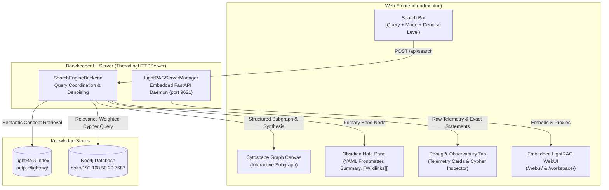

# 🌐 Interactive Idea-Based Search Engine & Web UI

Bookkeeper features a web-based Idea Search Engine and Knowledge Explorer backed by **Neo4j** and **LightRAG**. It provides natural language idea searching, interactive visual graph exploration, an Obsidian-styled detail note pane, smart noise filtering, and a dedicated telemetry debug inspector.

---

## 📋 Table of Contents

- [1. Architecture Overview](#1-architecture-overview)
- [2. UI Layout & Features](#2-ui-layout--features)
  - [Central Search Bar & Denoise Controls](#central-search-bar--denoise-controls)
  - [Two-Column Results Pane](#two-column-results-pane)
  - [Embedded LightRAG WebUI & Workspace Tab](#embedded-lightrag-webui--workspace-tab)
  - [Debug & Observability Tab](#debug--observability-tab)
- [3. Smart Denoising & Super-Hub Mitigation](#3-smart-denoising--super-hub-mitigation)
- [4. CLI Usage & Launch Modes](#4-cli-usage--launch-modes)
  - [Mode A: Unified Bookkeeper UI + Embedded LightRAG](#mode-a-unified-bookkeeper-ui--embedded-lightrag)
  - [Mode B: Standalone Bookkeeper UI](#mode-b-standalone-bookkeeper-ui)
  - [Mode C: Standalone Official LightRAG Server](#mode-c-standalone-official-lightrag-server)
- [5. API Endpoints](#5-api-endpoints)

---

## 1. Architecture Overview



---

## 2. UI Layout & Features

### Central Search Bar & Denoise Controls
- **Free-Form Natural Language Querying**: Ask high-level questions (e.g. *"What is KV cache and how does it optimize attention?"* or *"What are time horizons in AI difficulty estimation?"*).
- **Retrieval Modes**: Select between LightRAG dual-level search modes:
  - `Hybrid (Local + Global)` (Default): Balances direct entity neighborhoods with broad thematic summaries.
  - `Local`: Prioritizes specific entity nodes and 1-hop connections.
  - `Global`: Retrieves high-level thematic summaries.
  - `Mix`: Blends vector search chunks with knowledge graph relations.
- **Denoise Selector**:
  - `Strict` (Degree $\le$ 60): Eliminates generic boilerplate and limits hub expansion for clean graphs.
  - `Standard` (Degree $\le$ 120, Default): Balances graph density while suppressing structural terms.
  - `Relaxed` (Degree $\le$ 250): Displays broader interconnected clusters.

### Two-Column Results Pane
- **Left Column (Graph Visualization)**:
  - Powered by **Cytoscape.js** with multiple layout presets (`cose` physics layout, `concentric`, and `fit`).
  - Nodes are styled and categorized with distinct icons and colors:
    - 💡 / 🧠 **Concepts & Ideas** (Gold / Violet, sized proportionally to significance weight $0-10$)
    - 📚 **Books** (Blue)
    - 📑 **Sections & Chapters** (Emerald)
    - 📄 **Evidence Chunks** (Slate)
  - Clicking any node dynamically loads its details into the right-hand panel.
- **Right Column (Obsidian Detail Panel)**:
  - Formatted like a rich Markdown note with YAML frontmatter (`id`, `category`, `weight`, `occurrences`).
  - Rendered with Markdown headers, bullet points, and clickable `[[wikilinks]]`.
  - Displays linked books, related concepts, and chunk citation quotes with source breadcrumbs.

### Embedded LightRAG WebUI & Workspace Tab
- When started with `--lightrag-server`, the UI includes a dedicated **⚡ LightRAG WebUI** tab in the top navigation.
- Directly renders LightRAG's official document manager, vector search inspector, and entity graph viewer in an embedded view.
- Provides quick buttons to launch the `/webui/` or `/workspace/` query interfaces in separate browser tabs.

### Debug & Observability Tab
Designed for system transparency and troubleshooting:
- **Exact Prompt Sent to LightRAG**: The exact prompt string, query mode, and retrieval parameters.
- **Raw LightRAG Response & Candidate Terms**: Full unparsed text and candidate concepts extracted by the denoiser.
- **Exact Cypher Executed in Neo4j**: Complete Cypher statement with parameters and execution duration in seconds.

---

## 3. Smart Denoising & Super-Hub Mitigation

When queries match generic conceptual labels, standard graph retrieval can flood the canvas with trivial nodes (such as *"Definition"*, *"Example"*, *"Concept"*, *"Role"*, *"Title"*).

Bookkeeper solves this with a 3-layer denoise pipeline:
1. **Markdown Structure Stripping**: Regex candidate extraction specifically ignores markdown headers and bullet qualifiers unless explicitly part of the user's query.
2. **Relevance Boosting**: Candidate concepts sharing terms with the user query receive high relevance bonuses (`match_score`: exact = 120, prefix = 70, contains = 25).
3. **Degree-Based Super-Hub Penalty**: Over-connected hub nodes that exceed the selected degree threshold are excluded from seeding the graph.

---

## 4. CLI Usage & Launch Modes

### Mode A: Unified Bookkeeper UI + Embedded LightRAG
Starts both the Bookkeeper Idea Engine (port 8000) and the embedded LightRAG FastAPI server (port 9621) concurrently:

```bash
bookeeper ui --port 8000 --lightrag-server
```

Open your browser to:
- **Bookkeeper UI**: [http://127.0.0.1:8000/](http://127.0.0.1:8000/)
- **Embedded LightRAG WebUI Tab**: Available directly in the top navigation bar.

### Mode B: Standalone Bookkeeper UI
Launches only the Bookkeeper Idea Engine:

```bash
bookeeper ui --port 8000
```
*(If port 8000 is occupied, Bookkeeper automatically increments to the next free port, such as 8001).*

### Mode C: Standalone Official LightRAG Server
Runs the official LightRAG FastAPI server pointing to Bookkeeper's indexed storage directory:

```bash
bookeeper lightrag-ui --port 9621
```

Access:
- **WebUI**: `http://127.0.0.1:9621/webui/`
- **Workspace Query**: `http://127.0.0.1:9621/workspace/`
- **Swagger Docs**: `http://127.0.0.1:9621/docs`

---

## 5. API Endpoints

The Bookkeeper UI server provides a lightweight REST API:

| Endpoint | Method | Description |
| :--- | :--- | :--- |
| `/api/health` | `GET` | Health check returning Neo4j connection status and LightRAG server status. |
| `/api/search` | `POST` | Executes the Idea Search pipeline (`query`, `mode`, `denoise_level`, `top_k`, `graph_limit`). |
| `/api/node` | `GET` | Returns full properties and categorized relationships for a node (`?id=<node_id>`). |
