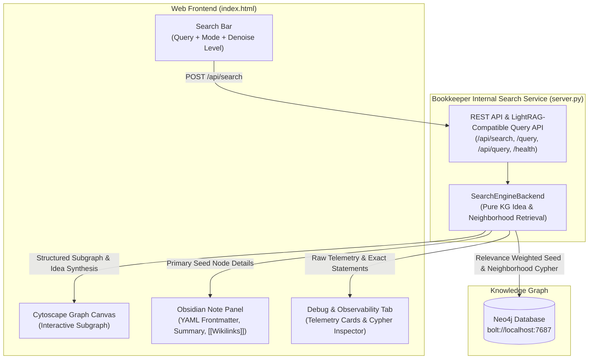

# 🌐 Interactive Idea-Based Search Engine & Web UI

Bookkeeper features a native web-based Idea Search Engine and Knowledge Explorer backed directly by **Neo4j**. It provides idea searching, interactive visual graph exploration, an Obsidian-styled detail note pane, smart noise filtering, a dedicated telemetry debug inspector, and an internal search service that mimics the LightRAG API (`/query`).

---

## 📋 Table of Contents

- [1. Architecture Overview](#1-architecture-overview)
- [2. UI Layout & Features](#2-ui-layout--features)
  - [Central Search Bar & Denoise Controls](#central-search-bar--denoise-controls)
  - [Two-Column Results Pane](#two-column-results-pane)
  - [Debug & Observability Tab](#debug--observability-tab)
- [3. Smart Denoising & Super-Hub Mitigation](#3-smart-denoising--super-hub-mitigation)
- [4. CLI Usage & Commands](#4-cli-usage--commands)
  - [Bookkeeper Web UI](#bookkeeper-web-ui)
  - [CLI Idea Search](#cli-idea-search)
- [5. API Endpoints (Including LightRAG-Compatible Service)](#5-api-endpoints-including-lightrag-compatible-service)

---

## 1. Architecture Overview



---

## 2. UI Layout & Features

### Central Search Bar & Denoise Controls
- **Idea Search**: Enter an idea or concept name (e.g. *"time horizon"*, *"kv-cache"*, *"consensus"*).
- **Retrieval Modes**:
  - `Ideas & 1-Hop Neighborhood` (Default): Retrieves matched seed ideas and their immediate concepts, books, and evidence notes.
  - `Deep Neighborhood (2-Hop)`: Expands interconnected conceptual paths up to 2 hops.
  - `Exact Idea Match`: Restricts seeds to exact concept names.
- **Denoise Selector**:
  - `Strict` (Degree $\le$ 60): Eliminates generic boilerplate and limits hub expansion for clean graphs.
  - `Standard` (Degree $\le$ 120, Default): Balances graph density while suppressing structural terms.
  - `Relaxed` (Degree $\le$ 250): Displays broader interconnected clusters.

### Two-Column Results Pane with Resizable Splitter & Foldable Panel
- **Proportion Resizing Splitter**:
  - A draggable vertical splitter (`.pane-resizer`) between the graph and description panel allows continuous custom sizing.
  - Smooth live canvas updates (`cyInstance.resize()`) during drag.
  - **Double-click** on the splitter divider instantly resets to the default 40% / 60% ratio.
  - Proportional width preferences persist automatically in `localStorage`.
- **Foldable Description Panel**:
  - **1-Click Collapse (`[ ❯ ]`)**: In the header of the description panel, clicking the chevron folds the panel completely away, expanding the graph to full 100% canvas width.
  - **1-Click Unfold (`[ 📖 Unfold Note ]`)**: A floating dock pill button appears in the top-right corner of the canvas to unfold the description panel back to its previous width.
  - **Auto-Unfold on Node Click**: Clicking any node or selecting "Open Note Details" while the panel is folded automatically unfolds the note panel to present the selected node's documentation.
  - Folded/unfolded state persists automatically across browser sessions.
- **Left Column (Graph Visualization)**:
  - Powered by **Cytoscape.js** with layout options:
    - **Centered Rings** (`concentric`, Default): Weight-driven concentric rings placing the highest-relevance core seed ideas at the center (level 0), connected concepts and books on middle rings, and secondary context nodes on the outer perimeter.
    - **⭐ Star Layout (Constellations)** (`star`): Multi-center **Constellation Gravitational Layout** (`computeConstellationLayout`). Detects prominent constellation centers with maximum references, points, and links. Each constellation star anchors its regional cosmic basin with dedicated spatial separation, while member nodes orbit naturally via gravitational physics, Fermat golden spiral phyllotaxis, edge springs, and anti-collision repulsion (preventing rigid line-ups or overlap).
    - **Force Layout** (`cose`): Physics-based simulation where edge tension and elasticity scale with relationship weight.
    - **Fit View**: Automatically frames and centers all visible graph elements.
  - **Organic Node Shapes & Inside-Node Scaled Titles (No Square Notes)**:
    - **No Square Shapes**: Every node on canvas uses smooth, organic curves (circular ellipses and rounded capsules/pills). Square and sharp box nodes are eliminated.
    - **Title Scaled Within Node**: Titles are centered directly inside each node (`text-valign: 'center'`, `text-wrap: 'wrap'`), with dimensions automatically scaled to comfortably enclose wrapped text with crisp contrast.
    - **Clean Typography (No Emoji Clutter)**: Canvas node labels feature clean typography without emoji prefixes. Rich metadata icons are preserved in the inspector panel and headers.
    - 🧠 **Core Seed Ideas** (`shape: ellipse`): Glowing Amber Gold (`#f59e0b`) circular star with 4.5px `#fde68a` border. Size: 90–120px.
    - 💡 **Connected Ideas / Concepts** (`shape: ellipse`): Vivid Violet (`#8b5cf6`) circular planet with 2.5px `#c4b5fd` border. Size: 74–102px.
    - 📚 **Source Books** (`shape: round-rectangle`): Ocean Blue (`#2563eb`) rounded pill capsule with 2.5px `#60a5fa` border. Size: 82–115px × 52–68px.
    - 📑 **Sections & Chapters** (`shape: round-rectangle`): Emerald Teal (`#0d9488`) rounded pill capsule with 2px `#34d399` border. Size: 70–98px × 44–56px.
    - 📄 **Evidence Chunks** (`shape: ellipse`): Charcoal Slate (`#334155`) smooth ellipse with 1.5px `#64748b` border. Size: 64–88px × 42–54px.
  - **Relationship Weighting**:
    - Concept $\leftrightarrow$ Concept edges: Weight 9.0, width 3.5px, accent indigo `#818cf8`.
    - Concept $\leftrightarrow$ Book edges: Weight 6.5, width 2.5px, blue `#3b82f6`.
    - Concept $\leftrightarrow$ Section edges: Weight 3.5, width 1.5px, gray `#475569`.
  - **1-Click Evidence Toggle & Canvas Deprioritization**:
    - **Default Clean Ideas View**: Secondary Page and Chunk nodes are hidden by default to keep the canvas strictly focused on core conceptions, interconnected ideas, and source books.
    - **1-Click Toggle Button (`[ 📄 Evidence: Hidden / Visible ]`)**: Instantly reveals or collapses all page/chunk evidence nodes dynamically on the canvas without re-querying the database.
    - **Non-Central Positioning**: When visible, page and chunk nodes are locked to the outermost periphery (lowest concentric rings, weight 1.5, size 16px, dark muted gray), ensuring they never steal visual prominence or central space from core ideas.
    - **Central Selection Guarantee**: The central focus node is strictly guaranteed to be an Idea or Concept (falling back to Book), never an arbitrary chunk or page container.
  - **Right Column (Obsidian Detail Panel)**:
    - Formatted like a rich Markdown note with YAML frontmatter (`id`, `category`, `weight`, `occurrences`).
    - Rendered with Markdown headers, bullet points, and clickable `[[wikilinks]]`.
    - **1-Click Supporting Evidence Reader**:
      - Every supporting chunk/section is displayed as a sleek 1-click accordion (`<details>`) with breadcrumbs, source book tags, and page numbers.
      - Expanding the item immediately reveals the full raw excerpt and quote inline.
      - Features **[ 📋 Copy Excerpt ]** and **[ 🎯 Center on Graph ]** buttons that immediately focus, unhide (if hidden), and zoom directly to that evidence node on the canvas.
    - Displays linked books, related concepts, and citation quotes with source breadcrumbs.

### Debug & Observability Tab
Designed for system transparency and troubleshooting:
- **Candidate Search Terms & Seed Ideas**: Displays normalized query terms and matched seed concepts.
- **Exact Cypher & Browser Parameters**: Complete Cypher statement prepended with `:param obj => ({props: {param_name: ...}})` parameter definitions with unquoted parameter names ready for direct copy-pasting into Neo4j Browser and Cypher tools.
  - **`$obj.props` Toggle**: Rewrites parameter references (e.g. `$obj.props.candidate_terms`, `$obj.props.max_seeds`) for direct one-click execution with the defined `:param obj` map.
  - **`$param` Toggle**: Preserves traditional parameter tokens (e.g. `$candidate_terms`, `$max_seeds`).
  - **Copy Cypher Button**: Copies the query in the currently selected interpolation format directly to the clipboard.
- **Graph Metrics**: Live counts of nodes and edges retrieved, along with Neo4j execution duration.

---

## 3. Smart Denoising & Super-Hub Mitigation

When queries match generic conceptual labels, standard graph retrieval can flood the canvas with trivial nodes (such as *"Definition"*, *"Example"*, *"Concept"*, *"Role"*, *"Title"*).

Bookkeeper solves this with a 3-layer denoise pipeline:
1. **Candidate Term Extraction & Question Cleaning**: Strips conversational prefixes ("What is...", "How does...") and ignores generic structural concepts unless explicitly queried.
2. **Relevance Boosting**: Candidate concepts sharing terms with the user query receive high relevance bonuses (`match_score`: exact = 150, prefix = 90, contains = 50, description = 25).
3. **Degree-Based Super-Hub Penalty**: Over-connected hub nodes that exceed the selected degree threshold are excluded from seeding the graph.

---

## 4. CLI Usage & Commands

### Bookkeeper Web UI
Launches the interactive Web UI and internal search API:

```bash
bookeeper ui --port 8000
```
*(If port 8000 is occupied, Bookkeeper automatically increments to the next free port, such as 8001).*

Access:
- **Web Interface**: `http://127.0.0.1:8000/`
- **LightRAG-Compatible Query API**: `http://127.0.0.1:8000/query`

### CLI Idea Search
Query ideas directly in your terminal:

```bash
bookeeper search "time horizon"
bookeeper search "kv-cache" --mode deep
```

### Official LightRAG Web UI & Graph Visualizer
Launches the embedded official LightRAG FastAPI server and WebUI on Bookkeeper's indexed LightRAG storage or A/B benchmark results:

```bash
# Automatically finds the most recent A/B test or default storage
bookeeper lightrag-ui

# Or point to a specific A/B benchmark run
bookeeper lightrag-ui --lightrag-dir ab_test_runs/run_20261014_144807
```

Access:
- **WebUI Interface**: `http://127.0.0.1:9621/webui/` (Visual graph canvas, entity inspector, documents, and search)
- **Workspace Query**: `http://127.0.0.1:9621/workspace/`
- **Swagger / OpenAPI Documentation**: `http://127.0.0.1:9621/docs`

---

## 5. API Endpoints (Including LightRAG-Compatible Service)

The Bookkeeper UI server provides both the native Web UI API and a **LightRAG-compatible Query API**:

| Endpoint | Method | Description |
| :--- | :--- | :--- |
| `/health` / `/api/health` | `GET` | Health check returning service status and Neo4j connection details. |
| `/query` / `/api/query` | `POST` | **LightRAG-compatible Query API**. Accepts `{"query": "...", "mode": "...", "include_references": true}` and returns `{response, references, response_time, llm_generated, graph}`. |
| `/api/search` | `POST` | Native Web UI Search endpoint returning query synthesis, graph elements, and telemetry. |
| `/api/node` | `GET` | Returns full properties and categorized relationships for a node (`?id=<node_id>`). |
| `/api/node/expand` | `POST`, `GET` | **Interactive Undirected Neighborhood Expansion** (Neo4j Browser-style). Pulls undirected 1-hop connected neighbors (`all`, `Concept`, `Book`, `Chunk`, `Section`). |

---

## 6. Interactive Node Neighborhood Expansion (Neo4j Browser Style)

Similar to the Neo4j Browser / Neo4j Bloom exploration experience, users can interactively expand any node directly on the Cytoscape graph canvas:

1. **Right-Click on any Node**:
   - Opens a floating context menu at the mouse cursor.
   - Displays the node's name, type badge, and icon.
2. **Unified or Typed Sub-Neighborhood**:
   - 🌐 **Expand All Neighbors**: Pulls all connected ideas, books, chunks, and sections unified in undirected order (`(n)-[rel]-(neighbor)`).
   - 💡 **Connected Ideas & Concepts**: Filters to related conceptual nodes.
   - 📚 **Referenced Books**: Expands referenced literature and books.
   - 📄 **Evidence Chunks**: Pulls supporting textual chunks and automatically sets evidence visibility so they are shown immediately.
   - 📑 **Sections & Chapters**: Pulls structural headings.
   - 📖 **Open Note Details**: Direct 1-click jump to inspect the Obsidian markdown view in the right panel.
3. **Deduplication & Session Ephemerality**:
   - Nodes and edges already present on the canvas are never duplicated (`cyInstance.getElementById(...)` check).
   - The expanded subgraph integrates smoothly with the active layout (`cyInstance.nodes(':visible').layout(...)`).
   - The expanded elements persist only during the interactive exploration session; executing a new search query cleanly resets the canvas without polluting or bloating subsequent searches.

