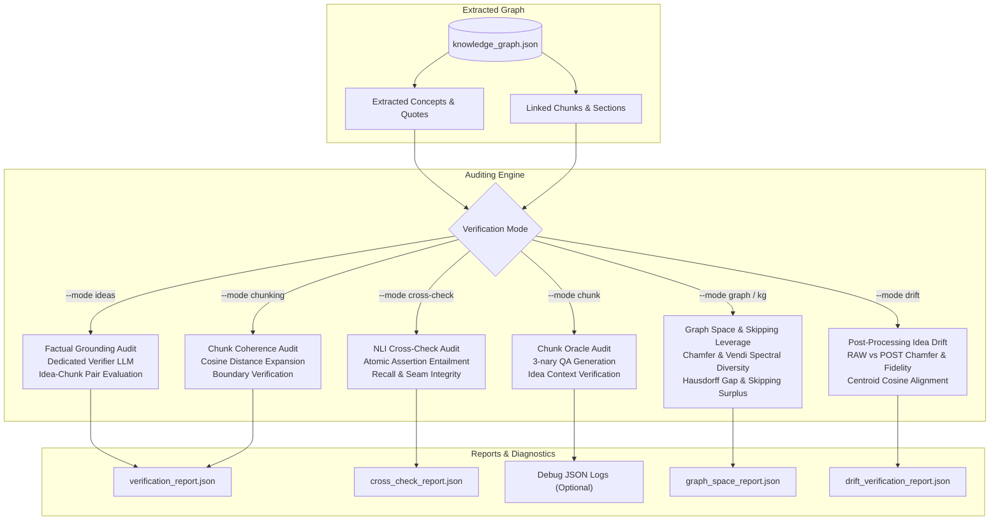

# 🛡️ Factual Verification & Auditing

Bookkeeper incorporates a comprehensive, multi-mode verification framework to audit the factual accuracy, semantic coherence, and integrity of extracted Knowledge Graphs against their original source texts.

---

## 📋 Table of Contents

- [1. Verification Overview & Architecture](#1-verification-overview--architecture)
- [2. Multi-Verification Configuration](#2-multi-verification-configuration)
- [3. Verification Modes](#3-verification-modes)
  - [Mode 1: Ideas Grounding Audit (`--mode ideas`)](#mode-1-ideas-grounding-audit---mode-ideas)
  - [Mode 2: Semantic Chunking Coherence (`--mode chunking`)](#mode-2-semantic-chunking-coherence---mode-chunking)
  - [Mode 3: Dual-KG Cross-Check Audit (`--mode cross-check`)](#mode-3-dual-kg-cross-check-audit---mode-cross-check)
  - [Mode 4: Chunk Oracle Alignment (`--mode chunk`)](#mode-4-chunk-oracle-alignment---mode-chunk)
  - [Mode 5: Graph Embedding Space & Skipping Leverage (`--mode graph` / `--mode kg`)](#mode-5-graph-embedding-space--skipping-leverage---mode-graph----mode-kg)
  - [Mode 6: Post-Processing Idea Drift & Semantic Alignment (`--mode drift`)](#mode-6-post-processing-idea-drift--semantic-alignment---mode-drift)
- [4. Memory Guard Architecture (10 GB Ceiling)](#4-memory-guard-architecture-10-gb-ceiling)
- [5. Debug JSON Logging (`--debug-json`)](#5-debug-json-logging---debug-json)
- [6. Automated Test-Run Pipeline (`test-run`)](#6-automated-test-run-pipeline-test-run)
- [7. Full CLI Reference](#7-full-cli-reference)
- [8. Next Steps](#8-next-steps)

---

## 1. Verification Overview & Architecture

Large Language Models can occasionally hallucinate technical attributes, drop conditions, or attribute quotes to incorrect sections. Bookkeeper's verification engine acts as an independent auditor:



---

## 2. Multi-Verification Configuration

You can configure verification in `config.yaml` either as a single verifier or as an array of multi-verifiers:

```yaml
# Primary single verification settings:
verification:
  enabled: true
  model: "llama3.1:8b"               # Dedicated capable auditor model
  percent: 1.0                       # Default sample percentage (1.0%)
  max_examples: 20                   # Max discrepancy examples printed in terminal
  cooldown_seconds: 60               # Short failover cooldown for fast retry

# Optional multi-verifier suite:
verifiers:
  - name: "fast-audit"
    model: "llama3.1:8b"
    percent: 1.0
    mode: "ideas"
  - name: "deep-audit"
    model: "qwen2.5:14b-instruct"
    percent: 5.0
    mode: "ideas"
```

Execute all configured verifiers simultaneously:
```bash
bookeeper verifiers
```

---

## 3. Verification Modes

### Mode 1: Ideas Grounding Audit (`--mode ideas`, Default)

Audits whether concepts, definitions, and relationships in `knowledge_graph.json` are factually supported by their assigned text chunks using a dedicated verifier model:

```bash
# Verify 1% of all ideas (default):
bookeeper verify

# Verify 5% of ideas using a custom verifier model:
bookeeper verify --mode ideas --percent 5.0 --model "qwen2.5:14b-instruct"

# Limit discrepancy examples shown in terminal (default: up to 20):
bookeeper verify --max-examples 10

# Save audit report to custom destination with reproducible seed:
bookeeper verify --output ./output/audit_report.json --seed 42
```

**Key Outputs:**
- **Live Status Display**: Shows active idea and book, current ETA, task rate, and verified support percentage.
- **Statistical Summary**: Total ideas in graph, evaluated idea-chunk pairs, **Verified / Supported %**, and **Discrepancy / Unsupported %**.
- **Discrepancy Table**: Rich table displaying unsupported ideas, chunk IDs, source quotes, and verifier reasoning.
- **Server Effort Breakdown**: Duration, throughput, and valuable characters processed across each Ollama server.

---

### Mode 2: Semantic Chunking Coherence (`--mode chunking`)

Evaluates the boundary precision and semantic consistency of stored chunks using sentence expansion embeddings:

```bash
# Verify chunk coherence for a specific book by ID:
bookeeper verify --mode chunking --book-id 42

# Verify chunk coherence across all books in library:
bookeeper verify --mode chunking --all

# Set custom cosine distance threshold (default: 0.20):
bookeeper verify --mode chunking --book-id 42 --threshold 0.18

# Use dedicated embedding endpoint or model:
bookeeper verify --mode chunking --book-id 42 --embedding-model "nomic-embed-text" --embedding-url "http://localhost:11434"
```

**What Chunking Mode Evaluates:**
- **Boundary Precision**: Confirms sentence-to-chunk cosine distances remain within accepted thresholds.
- **Semantic Drift Distribution**: Displays mean, min, max, and outlier distances across chapters.
- **Cache Consistency**: Validates that stored chunks in `output/chunks/` reflect smart semantic boundaries.

---

### Mode 3: Dual-KG Cross-Check Audit (`--mode cross-check`)

Compares factual retention across two knowledge graphs or chunking strategies using **Natural Language Inference (NLI) Atomic Assertion Entailment**:

```bash
# Compare candidate knowledge graph against baseline:
bookeeper verify --mode cross-check --compare-graph ./path/to/candidate_kg.json

# Audit 20 contiguous chunk blocks with a custom verifier model:
bookeeper verify --mode cross-check --compare-graph ./path/to/candidate_kg.json --blocks 20 --model "llama3.1:8b"

# Print side-by-side QA & Assertion probes for first 3 audited blocks:
bookeeper verify --mode cross-check --compare-graph ./path/to/candidate_kg.json --print-blocks 3
```

**How NLI Cross-Check Verification Works:**
1. **Exact Document Clamping**: Aligns contiguous chunk blocks between old and new graphs using forward-anchored exact character spans within the raw book text, eliminating span drift.
2. **Atomic Assertion Decomposition**: An Oracle model analyzes the canonical raw passage and extracts factual, declarative statements (atomic claims) representing key events, mechanisms, and conditions.
3. **Entailment Classification**: Evaluates each assertion against the extracted knowledge base ($E_{\text{old}}$ vs $E_{\text{new}}$), classifying each as `SUPPORTED`, `CONTRADICTED`, or `NOT_MENTIONED`.

**Metrics & Legend:**
- **Recall (NLI Recall)**:
  Proportion of raw-passage factual assertions verified as `SUPPORTED` by the extracted knowledge base claims and entities:
  $$\text{Recall} = \frac{\sum \text{Supported Assertions}}{\text{Total Assertions}}$$
- **Seam Integrity (SIMINT)**:
  Measures retention of relational propositions spanning across chunk seams/boundaries. Detects seam severance where a cause and consequence land on opposite sides of a chunk boundary and the relationship is severed:
  $$\text{SIMINT} = \frac{\sum \text{Supported Cross-Boundary Assertions}}{\text{Total Cross-Boundary Assertions}}$$
- **Chunk Disproportion**:
  Normalized character overlap ratio between candidate chunk span and canonical window:
  $$\text{Disproportion} = \frac{|A \cap B|}{|A \cup B|}$$

---

### Mode 4: Chunk Oracle Alignment (`--mode chunk`)

Evaluates per-chunk factual recall for a single knowledge base using synthetic Oracle probes:

```bash
bookeeper verify --mode chunk --blocks 15 --model "llama3.1:8b"
```

**Verification Flow:**
1. **Probe Generation**: The Oracle model analyzes a selected chunk and generates a 3-nary question (True / False / Cannot be determined).
2. **Context Population**: All ideas extracted from that same chunk are populated with their **full context** (canonical name + brief description + detailed explanation).
3. **Verification**: The question is verified strictly against the extracted idea context.
4. **Per-Chunk Recall**: Computes recall statistics per chunk to measure knowledge retention without requiring an external graph comparison.

### Mode 5: Graph Embedding Space & Skipping Leverage (`--mode graph` / `--mode kg`)

Evaluates how effectively extracted knowledge graph concept nodes $G$ cover and disperse across the entire literature corpus embedding universe $U$, and quantifies the exact efficiency and information retention of the chunk skipping heuristic:

```bash
# Evaluate graph embedding space and skipping leverage on current graph:
bookeeper verify --mode graph --tau 0.75

# Or use shorthand mode 'kg':
bookeeper verify --mode kg --tau 0.75

# Compare candidate graph space vs baseline or backup:
bookeeper verify --mode graph --compare-graph ./output/knowledge_graph.json --tau 0.75
```

> [!NOTE]
> Whenever book state checkpoints exist in `output/.book_states` (or when `--states-dir` is provided), `bookeeper verify --mode graph` / `kg` automatically executes **Post-Processing Idea Drift & Semantic Alignment** alongside the graph space metrics, displaying both tables and embedding the drift metrics into `graph_space_report.json`.

#### Core Metric Suite for Knowledge Graph Space

To eliminate distortion caused by chunk size variance (e.g. short 200-char transitional chunks vs dense 1,500-char technical explanations), all metrics are **size-weighted by chunk character length** $w_i = \text{char\_count}(c_i)$, measuring actual text volume rather than arbitrary chunk boundary counts:

| Metric | Category | Size-Weighted Formula / Definition | Operational Purpose |
| :--- | :--- | :--- | :--- |
| **Chamfer Coverage ($\mu$)** | Global Coverage | $\frac{\sum_{c_i \in U} w_i \max_{v \in G} \cos(c_i, v)}{\sum w_i}$ | Size-weighted expected semantic proximity of literature text to graph concepts. |
| **Coverage Std Dev ($\sigma$)** | Regularity | $\sqrt{\frac{\sum w_i (s_i - \mu)^2}{\sum w_i}}$ | Detects whether coverage is uniform (low $\sigma$) or clumped in few topics while leaving gaps (high $\sigma$). |
| **Worst-Decile ($p_{10}$)** | Tail Risk | Weighted 10th percentile of $\{s_i\}$ | Depth of semantic blind spots across the bottom 10% hardest text volume. |
| **Median ($p_{50}$)** | Robust Centrality | Weighted 50th percentile of $\{s_i\}$ | Typical proximity of text mass unaffected by heavy tails. |
| **Threshold Coverage ($\text{Cov}_\tau$)** | Bounded Recall | $\frac{\sum_{s_i \ge \tau} w_i}{\sum w_i} \times 100$ | Percentage of the total literature text volume reachable within cosine radius $\tau$ (default: 0.75). |
| **Directed Hausdorff ($d_H$)** | Maximum Blind Spot | $\max_{c \in U} \min_{v \in G} (1 - \cos(c, v))$ | Absolute worst-case gap in the graph (distance to the single most isolated chunk). |
| **Vendi Score ($VS$)** | Extrinsic Diversity | $\exp\left(-\sum \lambda_i \ln \lambda_i\right)$ where $\lambda = \text{eig}(K / \|G\|)$ | Effective number of orthogonal, non-redundant concept directions spanned by $G$. |
| **Compression Efficiency** | Node Economy | $\frac{\text{Cov}_\tau(G, U)}{\|V_G\|}$ | Percentage of total corpus space covered per node retained in the graph. |

#### Skipping Mechanism Leverage Suite

Comparing **Threshold Coverage ($\text{Cov}_\tau$)** against the **Extraction (Parent) Ratio ($\rho_{\text{parent}}$)** evaluates whether bypassed text volume is successfully represented:

* Let $W = \sum_{c \in U} w_c$: Total character volume of the universe.
* $W_{\text{parent}} = \sum_{c \in U_{\text{parent}}} w_c$: Character volume of chunks from which an idea was extracted.
* $W_{\text{skipped}} = W - W_{\text{parent}}$: Character volume of chunks deliberately bypassed.
* **Extraction Ratio ($\rho_{\text{parent}} = \frac{W_{\text{parent}}}{W}$)**: Fraction of corpus text volume spent on LLM compute.
* **Generalization Surplus ($\Delta_{\text{cov}} = \text{Cov}_\tau - \rho_{\text{parent}}$)**:
  - $\Delta_{\text{cov}} > 0$: Skipping heuristic is working. Extracted ideas act as genuine semantic umbrellas covering skipped text for free.
  - $\Delta_{\text{cov}} \approx 0$: Ideas are narrow and only cover their own immediate parent text.
* **Compression Leverage Ratio ($L_{\text{comp}} = \frac{\text{Cov}_\tau}{\rho_{\text{parent}}}$)**:
  - Factor of text space represented per unit of corpus processed (e.g. $L_{\text{comp}} = 2.5\times$ means each 1% of processed text mass represents 2.5% of total corpus concept space).
* **Skipped Text Retention Rate ($R_{\text{skipped}}$)**:
  $$R_{\text{skipped}} = \frac{\sum_{c \in U_{\text{skipped}}, \max_v \cos(c, v) \ge \tau} w_c}{W_{\text{skipped}}}$$
  Direct percentage of deliberately ignored text volume that remains safely within semantic radius $\tau$.

#### Worst-Decile Verification Prompt Generation (`--low-p10-prompt`)

The bottom decile of semantic coverage ($p_{10}$) captures chunks whose text lies farthest from any concept in the Knowledge Graph. To rigorously verify whether these tail chunks represent **genuine omissions** (missed domain insights) or **justified skips** (indices, copyright notices, math derivations, tabular noise), Bookkeeper can automatically generate a ~1M context verification audit prompt for frontier models (e.g., Gemini 1.5 Pro, Claude 3.5 Sonnet, GPT-4o):

```bash
# Generate low-p10 audit prompt to default output/low_p10_verification_prompt.txt:
bookeeper verify --mode kg --low-p10-prompt

# Specify custom prompt output file and evaluate candidate graph:
bookeeper verify --mode kg --low-p10-prompt --low-p10-output ./output/p10_eval_prompt.txt
```

**Key Features:**
1. **Targeted Tail Sampling**: Extracts the lowest 10% proximity chunks ranked strictly by cosine similarity against all Knowledge Graph concept nodes.
2. **Sequential Token Budget Packing**: Progressively packs chunks up to a ~1,000,000 character ceiling (~250,000 tokens), preserving complete chunk texts without truncation.
3. **Structured Chunk Delimiters**: Formats each chunk with clear bounding banners:
   ```text
   ================================================================================
   CHUNK 1/1379 [ID: book_1_chunk_42] | Proximity: 0.5421 | Length: 842 chars
   ================================================================================
   <raw chunk content>
   ```
4. **Frontier Model Evaluation Template**: Instructs the frontier model to return a structured evaluation report:
   - **Percentage of Chunks with Specific Ideas**: Ratio of chunks containing real, substantive ideas vs boilerplate/generic text.
   - **Total Missed Ideas Count**: Number of distinct technical concepts that should have been captured.
   - **Itemized Missed Idea Breakdown**: Chunk ID, concept name, brief definition, and supporting quote.

---

### Mode 6: Post-Processing Idea Drift & Semantic Alignment (`--mode drift`)

When post-processing (deduplication, clustering, synthesis, pruning) transforms RAW extracted ideas ($R = \{r_1, \dots, r_{N_R}\}$ from per-book state checkpoints) into POST knowledge graph ideas ($P = \{p_1, \dots, p_{N_P}\}$), $N_R \ne N_P$. You cannot perform point-to-point comparisons.

Mode `drift` measures the deformation, alignment, and information retention across both vector spaces strictly in Cosine Similarity space $[0, 1]$:

```bash
# Verify post-processing idea drift on the active knowledge graph:
bookeeper verify --mode drift

# Audit drift for a specific book against a custom state checkpoints directory:
bookeeper verify --mode drift --states-dir ./output/.book_states --book-id 1 --tau-loss 0.70

# Save detailed drift verification report:
bookeeper verify --mode drift -o ./output/drift_report.json
```

#### Core Metric Suite for Post-Processing Idea Drift

| Metric | Space | Formula / Definition | Benchmark Interpretation |
| :--- | :---: | :--- | :--- |
| **Forward Retention ($S_{R \to P}$)** | $[0, 1]$ | $\frac{1}{N_R} \sum_{i=1}^{N_R} \max_{j} \cos(r_i, p_j)$ | **$>0.85$**: Lossless deduplication.<br>**$<0.75$**: Over-merging or semantic loss. |
| **Backward Fidelity ($S_{P \to R}$)** | $[0, 1]$ | $\frac{1}{N_P} \sum_{j=1}^{N_P} \max_{i} \cos(p_j, r_i)$ | **$>0.88$**: Strictly anchored to raw source statements.<br>**$<0.75$**: Hallucination / unwarranted synthesis drift. |
| **Symmetric Idea Drift Score ($F_{1, \text{sim}}$)** | $[0, 1]$ | $2 \cdot \frac{S_{R \to P} \cdot S_{P \to R}}{S_{R \to P} + S_{P \to R}}$ | Harmonic mean balancing retention and fidelity. |
| **Weighted Retention ($S_{R \to P}^{\text{weighted}}$)** | $[0, 1]$ | $\sum_{i=1}^{N_R} \frac{w_i}{\sum w_k} \max_j \cos(r_i, p_j)$ | Retention weighted by evidence quote character length $w_i = \text{len}(\text{quote}_i)$. |
| **Centroid Cosine Alignment** | $[-1, 1]$ | $\cos(\bar{R}, \bar{P}) = \frac{\bar{r} \cdot \bar{p}}{\|\bar{r}\| \|\bar{p}\|}$ | **$\ge 0.96$**: Global theme preserved.<br>**$<0.96$**: Macro topic shift or systemic pruning bias. |
| **Worst-Decile Retention ($p_{10}$)** | $[0, 1]$ | 10th percentile of $\{\max_j \cos(r_i, p_j)\}$ | Tail risk: proximity for bottom 10% worst-preserved raw ideas. |
| **Minimum Retention ($\min_{\text{sim}}$)** | $[0, 1]$ | $\min_i \max_j \cos(r_i, p_j)$ | Single most distorted or abandoned raw idea. |
| **Dropped Raw Ideas ($< \tau_{\text{loss}}$)** | Count / % | $\sum_{i=1}^{N_R} \mathbb{I}(\max_j \cos(r_i, p_j) < \tau_{\text{loss}})$ | Raw ideas whose nearest post match falls below cutoff $\tau_{\text{loss}}$ (default: 0.70). |

---

## 4. Memory Guard Architecture (10 GB Ceiling)

Evaluating tens of thousands of chunks and concept embeddings can quickly consume tens of gigabytes of RAM if implemented naively. Bookkeeper enforces an engineered memory budget keeping total process RSS strictly within **10.0 GB**:

1. **Dual Spectral Gram Matrix for Vendi Score ($< 5\text{ MB}$ Memory)**:
   - *Naive Approach*: Evaluating $K = \frac{1 + G G^T}{2}$ on $M = 30,000$ idea nodes requires a $30,000 \times 30,000$ matrix (7.2 GB for $K$, 7.2 GB for $K_{\text{norm}}$, and 14.4 GB for LAPACK work arrays = **28.8 GB total**).
   - *Dual Gram Formulation*: The non-zero eigenvalues of $\frac{1}{M} K$ are **identical** to the eigenvalues of the dual Gram matrix $C \in \mathbb{R}^{(D+1) \times (D+1)}$:
     $$C = \frac{1}{2} \begin{bmatrix} 1 & \bar{g}^T \\ \bar{g} & \frac{1}{M} G^T G \end{bmatrix}$$
   - For standard embedding dimension $D = 768$, $C$ is only $(769 \times 769)$, occupying **4.7 Megabytes** and computing eigendecomposition in **5 milliseconds** with machine-epsilon exact equivalence ($< 10^{-15}$).
2. **Memory-Bounded Cosine Projections (64 MB Chunk Cap)**:
   - Chunk similarity projections in `compute_max_cosine_sim_batched` dynamically size batches so intermediate matrix allocations never exceed 64 MB of RAM.
3. **Zero-Copy Vector Slicing**:
   - Replaced Python list-of-floats parsing (`vec.tolist()`) with contiguous `np.float32` array slices, eliminating tens of millions of heap-allocated Python float objects.
4. **Memory Watcher Ceiling**:
   - `MemoryGuard` continuously monitors process RSS via `psutil`.
   - Automatically triggers proactive garbage collection when usage crosses 85% of limit (8.5 GB).
   - Enforces the hard 10.0 GB ceiling (customizable via `BOOKEEPER_MEMORY_LIMIT_GB`).

---

## 5. Debug JSON Logging (`--debug-json`)

When debugging verification discrepancies, enable `--debug-json` to emit complete raw request payloads, contexts, and model responses:

```bash
bookeeper verify --mode chunk --blocks 5 --debug-json
```

- **Output File**: Saved alongside reports as `verification_debug_<timestamp>.json`.
- **Contents**: Full raw prompts, sentence-level extraction context, candidate answers, and verifier reasoning traces.
- **Default Behavior**: Disabled by default to prevent large log files and disk overhead.

---

## 6. Automated Test-Run Pipeline (`test-run`)

Executes an end-to-end integration test across a fixed number of books from scratch, then automatically launches factual grounding verification:

```bash
# Ingest 5 books from scratch and verify 1% of ideas:
bookeeper test-run 5

# Test run using an arXiv downloads folder as the book source:
bookeeper test-run 5 --books-dir archive_downloader/downloads

# Customize timeout, sample percentage, or verification mode:
bookeeper test-run 10 --timeout 60 --percent 2.0 --mode ideas
```

**Pipeline Workflow:**
1. **Stage 1 (Build Graph)**: Runs `build-graph` with `--from-scratch`, `--no-lightrag`, and `--clean-export`, processing books until exactly `{book-cnt}` books succeed.
2. **Stage 2 (Verification)**: Automatically triggers `bookeeper verify` to audit the resulting graph and display integrity statistics.

---

## 7. Full CLI Reference

```text
Usage: bookeeper verify [OPTIONS]

Options:
  -c, --config PATH               Path to config.yaml file.
  --graph-file PATH               Path to knowledge_graph.json or backup archive.
  -p, --percent FLOAT             Percentage of ideas to randomly verify (default: 1.0).
  -m, --mode [ideas|chunking|chunk|cross-check|graph|kg|drift]
                                  Verification mode (default: from config.yaml or 'ideas').
  --compare-graph PATH            Candidate graph or historical backup archive for cross-check / graph mode.
  --blocks INTEGER                Number of contiguous chunk blocks in cross-check mode (default: 20).
  --tau FLOAT                     Semantic proximity radius for graph space mode (default: 0.75).
  -b, --book-id INTEGER           Specific book ID to audit.
  --all                           Verify chunking across all stored books.
  --threshold FLOAT               Cosine distance threshold for chunk expansion (default: 0.20).
  --embedding-model TEXT          Dedicated embedding model name.
  --embedding-url TEXT            Ollama server URL dedicated for embeddings.
  --chunks-dir PATH               Directory containing stored book chunks.
  --model TEXT                    Dedicated LLM model for verification.
  --temperature FLOAT             Sampling temperature for verifier model (default: 0.0).
  --max-examples INTEGER          Max discrepancy examples displayed (default: 20).
  -o, --output PATH               Optional path to save JSON verification report.
  --seed INTEGER                  Random seed for reproducible sampling.
  --print-chunks INTEGER          Print text & QA probes for up to X blocks (cross-check mode).
  -t, --max-tasks INTEGER         Max concurrent worker tasks across Ollama servers.
  --cooldown INTEGER              Failover cooldown in seconds for verification tasks.
  --debug / --no-debug            Generate detailed debug JSON with raw prompts & responses.
  --debug-output PATH             Optional path to save debug JSON report.
  --stats-output PATH             Optional path to save standalone statistics JSON file.
  --states-dir PATH               Directory containing book state files for drift verification.
  --tau-loss FLOAT                Cosine similarity cutoff for dropped ideas in drift mode (default: 0.70).
  --low-p10-prompt                Generate ~1M context verification audit prompt for tail p10 chunks.
  --low-p10-output PATH           Custom output path for low-p10 prompt (default: output/low_p10_verification_prompt.txt).
```

---

## 8. Next Steps

- 🔬 **[A/B Testing & Benchmarking](ab-tests.md)** — Use verification in automated regression tests.
- 🏗️ **[Building the Knowledge Graph](building-graph.md)** — Graph extraction and options.
- 🧪 **[Two-Pass Idea Post-Processing (Experimental POC)](post-processing.md)** — Experimental synthesis details.
- 🏠 **[Return to Documentation Index](../README.md)**
