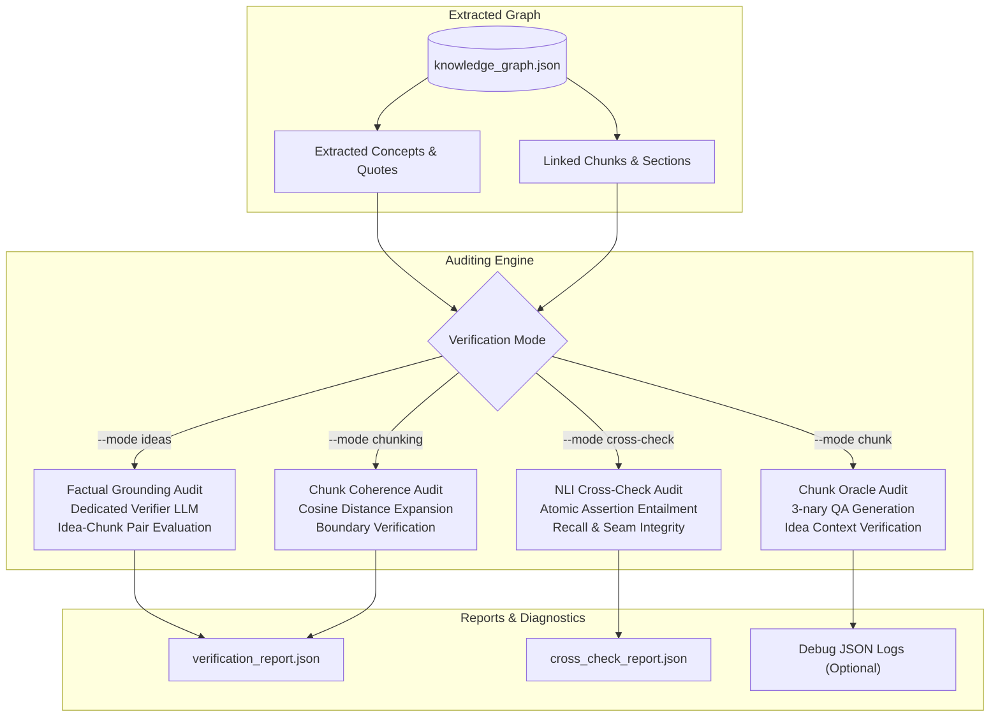

# 🛡️ Factual Verification & Auditing

Bookkeeper incorporates a comprehensive, multi-mode verification framework to audit the factual accuracy, semantic coherence, and integrity of extracted Knowledge Graphs against their original source texts.

---

## 📋 Table of Contents

- [1. Verification Overview & Architecture](#1-verification-overview--architecture)
- [2. Multi-Verification Configuration](#2-multi-verification-configuration)
- [3. Verification Modes](#3-verification-modes)
  - [Mode 1: Ideas Grounding Audit (`--mode ideas`)](#mode-1-ideas-grounding-audit---mode-ideas)
  - [Mode 2: Semantic Chunking Coherence (`--mode chunking`)](#mode-2-semantic-chunking-coherence---mode-chunking)
  - [Mode 3: Dual-KG Cross-Check Audit (`--mode cross-check`)](#mode-3-dual-kg-cross-check-audit---mode-cross-check)
  - [Mode 4: Chunk Oracle Alignment (`--mode chunk`)](#mode-4-chunk-oracle-alignment---mode-chunk)
- [4. Debug JSON Logging (`--debug-json`)](#4-debug-json-logging---debug-json)
- [5. Automated Test-Run Pipeline (`test-run`)](#5-automated-test-run-pipeline-test-run)
- [6. Full CLI Reference](#6-full-cli-reference)
- [7. Next Steps](#7-next-steps)

---

## 1. Verification Overview & Architecture

Large Language Models can occasionally hallucinate technical attributes, drop conditions, or attribute quotes to incorrect sections. Bookkeeper's verification engine acts as an independent auditor:



---

## 2. Multi-Verification Configuration

You can configure verification in `config.yaml` either as a single verifier or as an array of multi-verifiers:

```yaml
# Primary single verification settings:
verification:
  enabled: true
  model: "llama3.1:8b"               # Dedicated capable auditor model
  percent: 1.0                       # Default sample percentage (1.0%)
  max_examples: 20                   # Max discrepancy examples printed in terminal
  cooldown_seconds: 60               # Short failover cooldown for fast retry

# Optional multi-verifier suite:
verifiers:
  - name: "fast-audit"
    model: "llama3.1:8b"
    percent: 1.0
    mode: "ideas"
  - name: "deep-audit"
    model: "qwen2.5:14b-instruct"
    percent: 5.0
    mode: "ideas"
```

Execute all configured verifiers simultaneously:
```bash
bookeeper verifiers
```

---

## 3. Verification Modes

### Mode 1: Ideas Grounding Audit (`--mode ideas`, Default)

Audits whether concepts, definitions, and relationships in `knowledge_graph.json` are factually supported by their assigned text chunks using a dedicated verifier model:

```bash
# Verify 1% of all ideas (default):
bookeeper verify

# Verify 5% of ideas using a custom verifier model:
bookeeper verify --mode ideas --percent 5.0 --model "qwen2.5:14b-instruct"

# Limit discrepancy examples shown in terminal (default: up to 20):
bookeeper verify --max-examples 10

# Save audit report to custom destination with reproducible seed:
bookeeper verify --output ./output/audit_report.json --seed 42
```

**Key Outputs:**
- **Live Status Display**: Shows active idea and book, current ETA, task rate, and verified support percentage.
- **Statistical Summary**: Total ideas in graph, evaluated idea-chunk pairs, **Verified / Supported %**, and **Discrepancy / Unsupported %**.
- **Discrepancy Table**: Rich table displaying unsupported ideas, chunk IDs, source quotes, and verifier reasoning.
- **Server Effort Breakdown**: Duration, throughput, and valuable characters processed across each Ollama server.

---

### Mode 2: Semantic Chunking Coherence (`--mode chunking`)

Evaluates the boundary precision and semantic consistency of stored chunks using sentence expansion embeddings:

```bash
# Verify chunk coherence for a specific book by ID:
bookeeper verify --mode chunking --book-id 42

# Verify chunk coherence across all books in library:
bookeeper verify --mode chunking --all

# Set custom cosine distance threshold (default: 0.20):
bookeeper verify --mode chunking --book-id 42 --threshold 0.18

# Use dedicated embedding endpoint or model:
bookeeper verify --mode chunking --book-id 42 --embedding-model "nomic-embed-text" --embedding-url "http://localhost:11434"
```

**What Chunking Mode Evaluates:**
- **Boundary Precision**: Confirms sentence-to-chunk cosine distances remain within accepted thresholds.
- **Semantic Drift Distribution**: Displays mean, min, max, and outlier distances across chapters.
- **Cache Consistency**: Validates that stored chunks in `output/chunks/` reflect smart semantic boundaries.

---

### Mode 3: Dual-KG Cross-Check Audit (`--mode cross-check`)

Compares factual retention across two knowledge graphs or chunking strategies using **Natural Language Inference (NLI) Atomic Assertion Entailment**:

```bash
# Compare candidate knowledge graph against baseline:
bookeeper verify --mode cross-check --compare-graph ./path/to/candidate_kg.json

# Audit 20 contiguous chunk blocks with a custom verifier model:
bookeeper verify --mode cross-check --compare-graph ./path/to/candidate_kg.json --blocks 20 --model "llama3.1:8b"

# Print side-by-side QA & Assertion probes for first 3 audited blocks:
bookeeper verify --mode cross-check --compare-graph ./path/to/candidate_kg.json --print-blocks 3
```

**How NLI Cross-Check Verification Works:**
1. **Exact Document Clamping**: Aligns contiguous chunk blocks between old and new graphs using forward-anchored exact character spans within the raw book text, eliminating span drift.
2. **Atomic Assertion Decomposition**: An Oracle model analyzes the canonical raw passage and extracts factual, declarative statements (atomic claims) representing key events, mechanisms, and conditions.
3. **Entailment Classification**: Evaluates each assertion against the extracted knowledge base ($E_{\text{old}}$ vs $E_{\text{new}}$), classifying each as `SUPPORTED`, `CONTRADICTED`, or `NOT_MENTIONED`.

**Metrics & Legend:**
- **Recall (NLI Recall)**:
  Proportion of raw-passage factual assertions verified as `SUPPORTED` by the extracted knowledge base claims and entities:
  $$\text{Recall} = \frac{\sum \text{Supported Assertions}}{\text{Total Assertions}}$$
- **Seam Integrity (SIMINT)**:
  Measures retention of relational propositions spanning across chunk seams/boundaries. Detects seam severance where a cause and consequence land on opposite sides of a chunk boundary and the relationship is severed:
  $$\text{SIMINT} = \frac{\sum \text{Supported Cross-Boundary Assertions}}{\text{Total Cross-Boundary Assertions}}$$
- **Chunk Disproportion**:
  Normalized character overlap ratio between candidate chunk span and canonical window:
  $$\text{Disproportion} = \frac{|A \cap B|}{|A \cup B|}$$

---

### Mode 4: Chunk Oracle Alignment (`--mode chunk`)

Evaluates per-chunk factual recall for a single knowledge base using synthetic Oracle probes:

```bash
bookeeper verify --mode chunk --blocks 15 --model "llama3.1:8b"
```

**Verification Flow:**
1. **Probe Generation**: The Oracle model analyzes a selected chunk and generates a 3-nary question (True / False / Cannot be determined).
2. **Context Population**: All ideas extracted from that same chunk are populated with their **full context** (canonical name + brief description + detailed explanation).
3. **Verification**: The question is verified strictly against the extracted idea context.
4. **Per-Chunk Recall**: Computes recall statistics per chunk to measure knowledge retention without requiring an external graph comparison.

---

## 4. Debug JSON Logging (`--debug-json`)

When debugging verification discrepancies, enable `--debug-json` to emit complete raw request payloads, contexts, and model responses:

```bash
bookeeper verify --mode chunk --blocks 5 --debug-json
```

- **Output File**: Saved alongside reports as `verification_debug_<timestamp>.json`.
- **Contents**: Full raw prompts, sentence-level extraction context, candidate answers, and verifier reasoning traces.
- **Default Behavior**: Disabled by default to prevent large log files and disk overhead.

---

## 5. Automated Test-Run Pipeline (`test-run`)

Executes an end-to-end integration test across a fixed number of books from scratch, then automatically launches factual grounding verification:

```bash
# Ingest 5 books from scratch and verify 1% of ideas:
bookeeper test-run 5

# Test run using an arXiv downloads folder as the book source:
bookeeper test-run 5 --books-dir archive_downloader/downloads

# Customize timeout, sample percentage, or verification mode:
bookeeper test-run 10 --timeout 60 --percent 2.0 --mode ideas
```

**Pipeline Workflow:**
1. **Stage 1 (Build Graph)**: Runs `build-graph` with `--from-scratch`, `--no-lightrag`, and `--clean-export`, processing books until exactly `{book-cnt}` books succeed.
2. **Stage 2 (Verification)**: Automatically triggers `bookeeper verify` to audit the resulting graph and display integrity statistics.

---

## 6. Full CLI Reference

```text
Usage: bookeeper verify [OPTIONS]

Options:
  -m, --mode [ideas|chunking|cross-check|chunk]
                                  Verification mode (default: ideas).
  -p, --percent FLOAT             Sample percentage of ideas to audit (default: 1.0).
  --model TEXT                    Dedicated LLM model for verification.
  --blocks INTEGER                Number of chunk blocks to evaluate in cross-check or chunk mode.
  --compare-graph PATH            Candidate knowledge graph path for cross-check mode.
  --print-blocks INTEGER          Print side-by-side assertion probes for first N blocks.
  --debug-json / --no-debug-json  Save detailed per-sentence raw prompts and results to JSON (default: False).
  --max-examples INTEGER          Max discrepancy examples printed in table (default: 20).
  -o, --output PATH               Destination JSON report path.
  --seed INTEGER                  Random seed for deterministic sampling.
```

---

## 7. Next Steps

- 🔬 **[A/B Testing & Benchmarking](ab-tests.md)** — Use verification in automated regression tests.
- 🏗️ **[Building the Knowledge Graph](building-graph.md)** — Graph extraction and options.
- 🧪 **[Two-Pass Idea Post-Processing (Experimental POC)](post-processing.md)** — Experimental synthesis details.
- 🏠 **[Return to Documentation Index](../README.md)**
