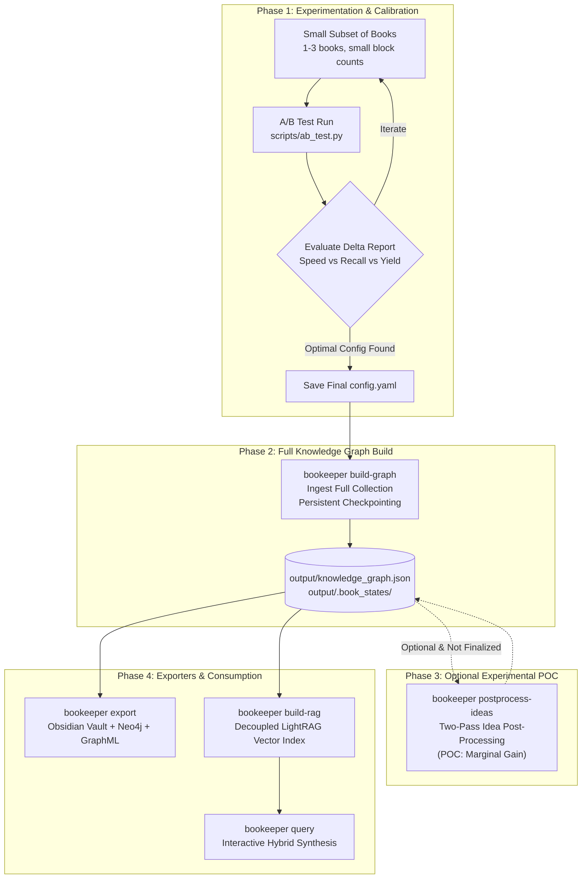

# 🔄 End-to-End Recommended Workflow

This guide details the **recommended operational workflow** for building and maintaining a production Knowledge Graph with Bookkeeper. Following this sequence prevents wasted GPU compute, identifies optimal chunking/model parameters for your specific library, and ensures verified factual accuracy.

---

## 📋 Recommended Pipeline Overview



---

## Step 1: Run Small A/B Tests to Find Your Balance

Before launching a full extraction run across hundreds of books, **always run an A/B test on a small sample (1–3 books, small chunk/block counts)** to verify your extraction hypothesis, evaluate model tradeoffs, and calibrate settings for your specific domain and book formats.

### Why Calibrate First?
- Digital libraries vary dramatically in technical density, vocabulary, and formatting (e.g. computer science textbooks vs. mathematical papers vs. narrative history).
- Testing on a small sample lets you discover the ideal balance between:
  - **Model Capacity vs. Speed**: e.g., evaluating whether `qwen2.5:3b` captures sufficient depth or if `llama3.1:8b` is required.
  - **Chunk Size & Overlap**: Testing whether smaller semantic chunks retain seam context or if larger windows are needed.
  - **Factual Grounding Recall**: Checking verification recall on a fast 1% sample before processing the whole library.

### Execution

Use the same-branch A/B testing harness with small book and block counts:

```bash
# Compare Config A vs Config B on a fast 2-book sample:
python3 scripts/ab_test.py \
  --books 2 \
  --percent 1.0 \
  --blocks 5 \
  --config config.yaml \
  --config-a config-a.yaml \
  --config-b config-b.yaml
```

Inspect the generated `ab_test_runs/run_<timestamp>/ab_test_summary.md` to review:
- Extraction throughput (seconds per book).
- Concepts yield and significance weight distributions.
- Factual grounding and cross-check NLI recall deltas.

Once satisfied, copy the winning settings into your main `config.yaml`.

*(For full details, see the **[A/B Testing Guide](ab-tests.md)**).*

---

## Step 2: Build the Knowledge Graph (`build-graph`)

With your configuration calibrated, launch the primary Knowledge Graph construction across your library:

```bash
# Ingest books with persistent checkpointing:
bookeeper build-graph --no-lightrag
```

### Best Practices:
- **Use `--no-lightrag`**: Bypasses heavy vector indexing during ingestion so Ollama focuses 100% of GPU compute on concept extraction.
- **Use `--skip-limbo-chunks`**: Accelerates extraction by bypassing ambiguous chunks ($0.65 \le \text{similarity} < 0.90$), prioritizing brand-new ideas and high-confidence direct matches.
- **Incremental Neo4j Sync**: Automatically syncs dirty nodes and edges to Neo4j every 10 books (`batch_books: 10`).
- **Resumability**: If interrupted via `Ctrl+C` or a power outage, simply re-run `bookeeper build-graph`. It automatically resumes from the last completed book checkpoint.
- **Offline Graph Rebuilds**: Once books are processed, their per-book states are preserved in `.book_states/`. If you ever need to wipe and rebuild your graph, run `bookeeper rebuild-graph` to reconstruct the entire graph in seconds without calling Ollama.

*(For full details, see **[Building the Knowledge Graph](building-graph.md)**).*

---

## Step 3: (Optional POC) Idea Post-Processing

> [!CAUTION]
> ### ⚠️ Experimental Proof-of-Concept (POC) — Not Finalized
> 
> **Idea Post-Processing (`postprocess-ideas` / `--dual-pass`) is an experimental Proof of Concept (POC) and is NOT finalized.**
> 
> In empirical benchmarks, this secondary aggregation pass yields **very low performance improvement** relative to the substantial additional LLM compute time and token overhead required.
> 
> **Recommendation:** Most users should **skip this step** and proceed directly to Step 4 (Export). Only run post-processing if you are actively conducting research on multi-pass entity reconciliation.

If you choose to experiment with this POC:

```bash
# Execute secondary idea reconciliation pass:
bookeeper postprocess-ideas
```

- Automatically saves progress checkpoints every 100 ideas (`.bookeeper_dual_pass_state.json`).
- If interrupted, re-running auto-continues without repeating already synthesized ideas.

*(For full details, see the **[Idea Post-Processing Guide](post-processing.md)**).*

---

## Step 4: Export to Your Knowledge Tools (`export`)

Once your Knowledge Graph is built, export it directly to your target visualization, note-taking, or database environments:

```bash
# Export to ALL destinations simultaneously (Obsidian, Neo4j, and GraphML) with embedding backfill:
bookeeper export --clean --backfill-embeddings
```

### Destination Specifics:

1. **Obsidian Markdown Vault** (`export-obsidian`):
   - Generates interconnected notes with Wikilinks, tags, and quotes.
   - Master index `00_Index.md` sorted by concept significance weight (0–10).
2. **Neo4j Property Graph** (`export-neo4j`):
   - High-throughput Cypher `MERGE` upsert with search index suspension (temporarily drops `VECTOR` and `FULLTEXT` indexes while preserving unique constraints).
   - Automatically recreates indexes in parallel post-ingestion and polls until `ONLINE`.
   - Enables Cypher graph querying, centrality analysis, Bloom visualization, and Web UI vector search.
3. **GraphML Export**:
   - Ready for visualization in Gephi or yEd.

*(For full details, see **[Standalone Exporters](building-graph.md#11-standalone-exporters--neo4j-high-throughput-ingestion)**).*

---

## Step 5: (Optional) Hybrid RAG Retrieval

To enable interactive, hallucination-resistant question answering across your library:

```bash
# 1. Index pre-extracted SSD chunks into LightRAG (offline):
bookeeper build-rag

# 2. Query interactively with hybrid graph + vector synthesis:
bookeeper query "What are the core consensus mechanisms and tradeoffs in Paxos versus Raft?"
```

*(For full details, see the **[Decoupled Hybrid RAG Guide](rag.md)**).*

---

## 📌 Summary Checklist

| Phase | Command | Goal |
| :--- | :--- | :--- |
| **1. Calibrate** | `python3 scripts/ab_test.py --books 2` | Find optimal model and chunk settings on small sample. |
| **2. Build** | `bookeeper build-graph --no-lightrag --skip-limbo-chunks` | Extract knowledge graph across your target library. |
| **3. POC (Optional)** | `bookeeper postprocess-ideas` | *(Experimental POC / Not Finalized)* At-most-once synthesis. |
| **4. Export** | `bookeeper export --clean --backfill-embeddings` | Export to Obsidian vault, Neo4j, and GraphML. |
| **5. Query (Optional)** | `bookeeper build-rag && bookeeper query` | Index into LightRAG and query interactively. |

---

## 🏠 Navigation

- 🚀 **[Getting Started](get-started.md)**
- 🏗️ **[Building the Knowledge Graph](building-graph.md)**
- 🔍 **[Decoupled Hybrid RAG](rag.md)**
- 🧪 **[Two-Pass Idea Post-Processing (Experimental POC)](post-processing.md)**
- 🔬 **[A/B Testing & Benchmarking](ab-tests.md)**
- 🛡️ **[Factual Verification & Auditing](verification.md)**
- 🏠 **[Return to Documentation Index](../README.md)**
